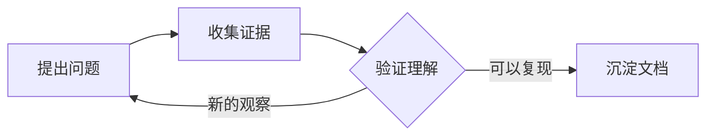

# 交互内容与日常工作流

所有内容仍保存为 Markdown。图表不执行 JavaScript，不请求在线图表服务；在其他 Markdown 工具中也能看到原始定义。整个空间、图片和交互资源继续受登录保护。

## 从实验室开始

导航「实验室」或 `/lab/` 可以试用流程图、图表、提示块和动效。点击「复制模板」复制 Markdown；「带入草稿」在写作空间创建演示草稿，不会直接发布。替换示例后，预览、发布即可，无需重新部署。

## 流程与关系图

用 `mermaid` 围栏描述关系，支持流程图、时序图、类图、状态图、关系图和思维导图：

````markdown

````

部件提供放大、缩小、还原和原始定义。绘图模块在图接近视口时从本网站加载，不在普通首页加载。资源加载失败时可明确选择「刷新页面并重试」；写作页会先等待当前保存和图片上传，失败则保留编辑并阻止刷新。超大图、配置指令、脚本、HTML、外部链接/图片会被拒绝，定义仍保留供检查。单定义最多20,000字符，每篇最多增强6张图；更大的关系建议分图表达。

## 可探索的数据图表

用 `chart` 围栏包裹 JSON：

````markdown
```chart
{
  "title": "演示数据 · 学习记录",
  "type": "line",
  "labels": ["周一", "周二", "周三"],
  "series": [
    { "name": "阅读", "values": [2, 4, 3] },
    { "name": "实践", "values": [1, 2, 4] }
  ]
}
```
````

`type` 为 `line` 或 `bar`。点击图例开关系列；鼠标悬停或用 Tab 聚焦数据点查看数值。「查看完整数据表」提供不依赖颜色的完整数据。浅色/深色主题自动调整颜色。

每张图最多60个横轴标签、6组数据；每组数值数量须与标签一致，且为绝对值不超过10¹²的有限数字。每篇最多增强12张图。错误会显示原因并保留原始JSON。

## 提示块

```markdown
> [!NOTE] 留给下次回访的线索
> 记录背景、证据与下一步。

> [!TIP]
> 先把问题拆小，再开始实验。

> [!WARNING]
> 这是一条演示提示，请替换为自己的内容。
```

## 交互教学模型

在 Markdown 中插入本站预定义的模型：

````markdown
```explore
{"kind":"inference","title":"改变负载，观察等待"}
```
````

`kind` 支持 `inference`（串行工作槽时间轴）、`go-request`（请求控制流）、`network`（分层诊断）。`title` 可选，最多 120 字符。每个定义最多 2,048 字符，每篇最多增强三个；额外字段、未知类型及无效 JSON 会显示错误并保留原文。定义不能携带脚本、HTML 或网络请求，模型不执行上传的 Go/Python 程序。

推理面板采用明确的构造工作单位，不是 GPU 测量或真实 TTFT 预测；改变输入长度、请求数和槽数可观察确定性时间轴。请求与网络模型支持场景切换、单步、播放、暂停、重置，默认不自动播放；隐藏标签页、离屏或移除组件时停止计时，减少动画模式保留手动步骤并禁用播放。模块接近视口才从本站加载；失败时正文与原定义仍可阅读，提供明确重试。

三篇完整示范、图解和独立代码验证见[长文资料](../examples/field-guides/README.md)。教学模型也可在现有写作预览中使用，无需修改存储格式或 CSP。

## 代码阅读卡片

在代码围栏前写一段可见说明：

````markdown
代码文件：`main.go`；重点行：2-3

```go
package main
func main() {
    println("hello")
}
```
````

文件名与重点行是显示提示，不用于访问文件。行号不会写进代码文本，复制结果保留原文。说明和行号不合法时退回普通代码块；所有代码块仍支持键盘聚焦与横向滚动。紧接代码的 `运行输出：` 段落及 `text` 代码块会提供输出折叠，默认展开。折叠不改变段落批注的文本上下文；定位输出内的批注会先展开目标。专注模式保留这些阅读控件。

正式文章会从实际二级标题生成最多四条「本篇线索」。带路线参数进入时，宽屏左侧列出该路线已发布的章/节，小屏折叠；原有目录、进度、上下节和完成操作继续保留。专注模式收起路线与目录。

## 写作快捷操作

- 在正文新行输入 `/` 打开插入菜单，用方向键选择、Enter插入、Esc关闭；代码围栏内不触发。
- 工具栏「插入内容块」也可插入标题、代码、表格、流程图、图表及提示块。
- 粘贴或拖入一张 PNG/JPEG/GIF/WebP，可上传并插入当前位置。每次一张、最多8MiB；多文件继续使用「导入文档」。普通文字粘贴保持原样。
- 上传期间可以继续输入，插入位置会跟随文字变化；前一张未完成时会提示等待。失败不会当作成功发布。
- 「专注写作」收起周围导航和列表，Esc退出；Ctrl/Cmd+S立即保存。工作稿与发布快照仍相互独立。
- Ctrl/Cmd+K打开全文搜索或快捷操作，输入 `>` 筛选操作；方向键选择，Enter执行。

## 阅读与动效

文章的「阅读设置」可调字号、内容宽度和行距，支持恢复默认；点击正文图片可放大查看，Esc 关闭。排版和主题偏好仅保存在当前浏览器；收藏、已读和阅读进度支持服务端同步，离线更改进入本机队列。状态、冲突、迁移与独立加密副本见[离线与同步说明](offline-and-sync.md)。

实验室动效试验台可切换星轨、光幕、呼吸并暂停。首页使用按需 OGL 主视觉，卡片与滚动效果按设备能力加载 GSAP/Lenis；后台、离屏或系统“减少动态效果”偏好下暂停或回退。正文与写作保持原生滚动，不做逐字飞入。完整令牌与降级策略见[设计系统](design-system.md)。

## 工程边界

检索使用服务端有界派生缓存，预算16MiB；更新与删除立即失效，工作稿与发布快照分别处理。每次查询仍验证文件状态，外部损坏不会被缓存掩盖。缓存可从现有JSON重建，不属于备份必需数据，也不是无限规模的数据库索引。服务端正式内容的备份方式见[内容指南](content-guide.md)。
