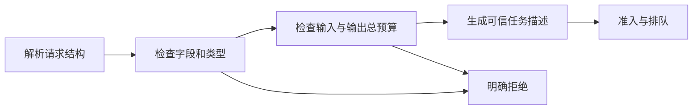

> [!NOTE] 生成演示
> 本文使用原创的离线教学协议，不对应任何厂商 API，也不调用模型或分词器。数字是人工构造的预算，不代表硬件性能或作者的生产经历。

## 先把“能回答”改写成可以检查的条件

你给一个服务发送文本，它返回了一段内容，这只能证明某一次调用走通了。基础设施还需要回答另外一些问题：请求太大时谁拒绝？用户关闭页面后资源什么时候释放？输出了一半就失败，客户端能不能安全重试？如果不同组件对“一次请求”的理解不一致，问题往往会被误认为模型不稳定。

这一章的目标是写出一份足够小、却能被程序验证的契约。读完你应当能区分字符、编码后的 token 数和预留的输出上限，并说明哪个字段由调用者提供，哪个字段必须由可信服务端生成。先修只需要认识 Python 的字典、列表和异常；请求时间线可以先读 [[演示 · 一次推理请求的旅程：从排队到第一个 token]]。

契约既包含字段，也包含承诺。比如“最多生成三十二个 token”不是“必须生成三十二个 token”；“收到请求”不是“已经为请求预留资源”。把这些差别写在入口处，后面讨论显存、排队和指标时就不必不断猜测前一个组件的意图。一个好的接口不需要提前暴露全部引擎参数，但应该明确所有会影响资源消耗的上界。

## 字符、字节和 token 是三种不同的计数

字符串长度取决于你数的是什么。字符数量不能直接替代 UTF-8 字节数，更不能直接替代某个模型分词器的 token 数。同一段文本经过不同词表、特殊 token 规则和聊天模板以后，得到的输入序列可能不同。因此“每个汉字等于一个 token”只能是某些粗略估计的假设，不应成为服务端预算检查的依据。

实际接入时，服务端通常需要先固定模型与 tokenizer 的对应版本，再应用完整输入模板，最后得到可验证的序列长度。本文跳过这一步，显式输入一组小整数作为教学 token ID。它们只用于数位置，不代表真实词表，也不包含用户提示词。这样可以把协议校验和模型行为分开验证。

| 名称 | 本章含义 | 可以用于什么 | 不能据此推断什么 |
| --- | --- | --- | --- |
| 原始文本 | 用户提供的字符串 | 展示与传输限制 | 确切 token 数 |
| 输入序列 | 可信编码步骤的结果 | 本次上下文长度 | 实际计算耗时 |
| 输出上限 | 本次允许继续生成的最大位置数 | 预算与结束条件 | 最终实际产出 |
| 请求标识 | 一次尝试的关联键 | 连接事件与日志 | 用户身份与权限 |

如果需要诊断一个长度问题，先记录模型标识、模板版本与计数边界，而不是把整段私有提示词写进日志。观察系统的目的是解释行为，保存大量原文并不会自动增加可解释性。关联标识也不应该被直接用作监控标签，否则每个请求都产生一条新的时间序列。

## 用总上下文预算连接输入和输出

我们定义一个只有十六个位置的教学窗口，输入有六个位置，最大输出为四个位置，合计十个，因此可以接受。若输入已经占十四个位置，即使输出只要求四个，也应在进入工作队列前拒绝。否则服务将把一个本来确定不可能完成的请求变成一次昂贵的后期失败。

这个加法只适用于本章定义的单序列、无截断教学协议。实际引擎可能有滑动窗口、缓存共享或不同的位置约束，不能直接把这里的十六换成某个模型宣称的长度就认为全部条件成立。接入时要核对模型和引擎共同支持的边界，以及特殊 token 是否已经计入。

另一个容易遗漏的细节是类型。Python 中布尔值属于整数的子类，如果校验器只判断是不是整数，`True` 就可能变成一个“合法的输出数量”。因此下面使用精确类型检查，并拒绝额外字段。严格校验可以更早暴露拼写错误，也能防止某一层偷偷接受另一个组件根本不理解的参数。



图中每个拒绝都发生在准入之前。客户端可以修正无效请求，但不应该把同一个非法输入重复发送多次。错误信息需要告诉调用者是哪项约束不满足，同时避免泄露内部路径、其他请求内容或认证配置。本文返回固定的短原因，方便测试；生产接口可以再建立稳定的错误码。

## 复制一个小而严格的校验器

下面的程序没有网络、文件写入或真实时钟。接受成功时返回新的不可变任务对象；失败时抛出异常，不修改输入字典。所有限制都在函数开头附近可见，方便后续把它们改成经过验证的配置，而不是散落在不同组件中。

代码文件：`contract.py`；重点行：14-28

```python
from dataclasses import dataclass
import re

@dataclass(frozen=True)
class Job:
    request_id: str
    input_ids: tuple
    max_output: int
    deadline_ms: int

def validate(raw, window=16):
    if type(window) is not int or window <= 0:
        raise ValueError("invalid window")
    if type(raw) is not dict or set(raw) != {
        "request_id", "input_ids", "max_output", "deadline_ms"
    }:
        raise ValueError("unexpected fields")
    name, ids = raw["request_id"], raw["input_ids"]
    output, deadline = raw["max_output"], raw["deadline_ms"]
    if type(name) is not str or not re.fullmatch(r"[a-z0-9-]{1,40}", name):
        raise ValueError("invalid request id")
    if type(ids) is not list or not 1 <= len(ids) <= window:
        raise ValueError("invalid sequence")
    if any(type(token) is not int or not 0 <= token < 100 for token in ids):
        raise ValueError("invalid teaching token")
    if type(output) is not int or output < 1 or len(ids) + output > window:
        raise ValueError("context budget exceeded")
    if type(deadline) is not int or not 1 <= deadline <= 10000:
        raise ValueError("invalid deadline")
    return Job(name, tuple(ids), output, deadline)

sample = {"request_id": "r-1", "input_ids": [1, 2, 3],
          "max_output": 4, "deadline_ms": 200}
assert validate(sample).input_ids == (1, 2, 3)
assert validate({**sample, "input_ids": [1] * 12}).max_output == 4
invalid = [
    {**sample, "max_output": True},
    {**sample, "input_ids": [False]},
    {**sample, "input_ids": [1] * 13},
    {**sample, "max_output": 0},
    {**sample, "deadline_ms": 0},
    {**sample, "extra": "not supported"},
]
for value in invalid:
    try:
        validate(value)
    except ValueError:
        continue
    raise AssertionError("invalid request accepted")
assert sample["input_ids"] == [1, 2, 3]
print("accepted=2 rejected=6 input_unchanged=True")
```

运行输出：

```text
accepted=2 rejected=6 input_unchanged=True
```

这段代码刻意不检查请求标识是否已经出现，因为去重需要跨请求状态，属于下一层的职责。同样，时间预算这里只确认是合法数值，没有把它转换成真实截止时间。服务接收时应以自己的可信时钟建立截止点，再把剩余预算传递给后续工作，不能直接相信客户端的绝对时间。

## 流式返回还需要结束契约

流式响应不是把普通响应拆成几段就完成了。我们至少要区分成功结束、预算耗尽、主动取消和执行失败；同一个请求只能进入一个终态。若输出已部分送达，之后发生错误，客户端应能知道内容并不完整，而不是把最后一次网络断开当作正常完成。

同一条流中的一个事件可能包含零个、一个或多个 token，也可能只是元数据。测量“首个事件”时必须注明是否排除了纯元数据；否则一个很早发送的空事件就能让指标看起来特别好。后面的负载实验会把事件边界写入数据结构，再讨论首响和完成时延。

取消也有两个观察点：客户端不再等待，以及服务端确实停止工作并释放资源。前一个发生，不保证后一个立即发生。契约可以要求取消信号传播到调度层，同时把取消确认和资源释放记录为不同事件。这样的设计使泄漏能被测到，而不是只能从显存或连接数上涨中猜测。

```recall
{"question":"为什么不能直接用文本字符数检查模型的总上下文预算？","answer":"token 数取决于对应分词器、特殊位置与输入模板。需要可信编码步骤得到实际输入长度，再结合输出上限检查总预算；字符数只能约束另一种输入规模。"}
```

## 实践：给契约加一条边界，而不是再加一个参数

先不看答案，给出三组输入：总长度恰好等于窗口、比窗口多一个位置、输出数量为布尔值。预测哪组接受，再运行校验器核对。接着把输入序列转换成元组后，检查后续改动原始列表是否会影响已经接受的任务。

完成本章的交付物是一页协议说明：输入如何计数、总预算怎样计算、错误是否可以重试、流如何明确结束、取消何时算完成。练习提示是把“用户希望什么”与“服务已经承诺什么”分开写；只有后者可以用于资源预留和对外保证。

如果实现扩展，优先加测试：空序列、负数位置、过长请求标识、未知字段都应被拒绝。不要把所有错误吞成成功的默认值，那样只是把入口错误延后成更加难懂的调度错误。下一章 [[演示 · AI 工程 02｜用确定性负载看懂时延与吞吐]] 会只接收已通过契约检查的构造任务。

## 来源与边界

分词不是固定的字符替换，真实接入应核对对应 tokenizer 与模板；可继续阅读 [Hugging Face 分词算法说明](https://huggingface.co/docs/transformers/main/tokenizer_summary)。本文的十六位置窗口、词表范围和协议字段全部是独立设计的教学约束，并非该文档中的接口配置。若要把入口放进真实 HTTP 程序，可衔接 [[演示 · 一条请求如何穿过 Go 程序]]，保留同样的错误与预算边界。
