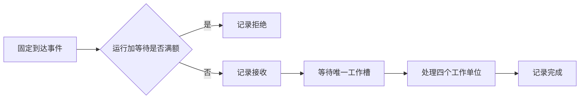

> [!NOTE] 生成演示
> 下文运行纯整数离散事件模型。所有时间都是构造工作单位，代码不发起压力测试、不调用模型，也不提供任何 GPU 性能结论。

## 为什么一个数字无法回答“服务快不快”

假设两份实验报告都写着“平均响应更快了”。第一份把长请求改成短请求，第二份在忙碌时直接拒绝新请求。它们可能都没有写错平均值，却不能证明原来的工作负载得到了更好的服务。速度必须和接收了什么、丢掉了什么、观察了多久一起解释。

这一章接在 [[演示 · AI 工程 01｜把一次生成请求变成可验证的契约]] 后面。我们不再争论输入是否合法，而是规定一条固定到达序列，让不同策略处理完全相同的任务。学习目标是区分到达率、完成率、等待和端到端时延，并在拒绝存在时保留完整分母。完成后你会得到一张可以手算、可以由程序复现的实验表。

这种实验的价值是让因果关系足够清楚。只改变一条准入规则，其余输入保持不变，就可以追问每一个变化发生在哪个环节。真实系统还会受到批处理、缓存、硬件频率和网络影响；在把这些因素加入之前，先确认基础账目守恒，会少走很多弯路。

## 先决定负载如何产生

本章使用开放到达序列：任务在预先写好的时间到达，不等待上一项完成。它适合暴露队列积累。另一种常见方式是固定客户端数量，每个客户端等一次返回后再发送下一次；服务变慢时，客户端自身会降低发送速度。这两种负载回答不同的问题，不能把相同的“并发数”当成相同实验。

我们的五个任务在时间零、一、二、三、八到达，每个任务固定需要四个单位处理时间。服务只有一个工作槽，不抢占，不合批。策略甲全部接收，策略乙最多保留两个未完成任务，包括正在运行的一个。这里的容量不是“两项排队加一项运行”，这个细小定义会直接改变拒绝数量。



服务端到达、开始和完成都在同一条模拟时钟上，因此可以直接相减。真实环境跨机器计算时延时，应优先使用单端的单调时钟跨度，或认真处理时钟同步误差。把不同机器的墙上时间直接相减，可能得到负等待，而负等待通常是观测链路的问题。

## 有限队列改变了什么

策略乙接收第一个任务，接收第二个任务，然后拒绝第三和第四个。时间八到达的新任务看到前两个已经结束，因此再次被接收。三个成功任务的完成时刻是四、八、十二，对应端到端时延是四、七、四。

策略甲则把五个任务全部串行处理完，完成时刻是四、八、十二、十六、二十。第三、第四个任务没有消失，只是付出了更长的等待。注意两组实验都在没有空转的情况下连续处理任务，所以本章构造模型里的完成吞吐同为每单位四分之一个任务。队列变长没有让工作槽更快。

| 策略 | 提交 | 接收并完成 | 拒绝 | 成功请求 p95 | 排空所需时间 |
| --- | ---: | ---: | ---: | ---: | ---: |
| 全部接收 | 5 | 5 | 0 | 13 | 20 |
| 最多两项未完成 | 5 | 3 | 2 | 7 | 12 |

所有时延和排空时间均以构造工作单位计。只展示 p95 会让策略乙显得全面胜出；同时展示拒绝数以后，取舍才完整。它把一些潜在的长等待变成了立即拒绝。如果调用者不能接受拒绝，这个策略并没有满足业务要求；若明确拒绝比长期占用更好，则可能是合理的保护。

## 让每个事件都有可复算的记录

代码把当前尚未结束的任务保存在列表里，遇到新请求先移除已完成项，再检查容量。比较使用小于等于，因此时间八完成的任务会在同一时刻的新请求到来前释放容量。这是明确的同刻事件规则；换成先接收再释放就会得到另一个结果，必须在实验说明里写出来。

代码文件：`load_model.py`；重点行：14-24

```python
from math import ceil

def run(arrivals, service=4, capacity=2):
    if type(service) is not int or service <= 0:
        raise ValueError("invalid service")
    if type(capacity) is not int or capacity < 1:
        raise ValueError("invalid capacity")
    if any(type(t) is not int or t < 0 for t in arrivals):
        raise ValueError("invalid arrivals")
    if list(arrivals) != sorted(arrivals):
        raise ValueError("arrivals must be ordered")
    active, rows, rejected = [], [], []
    available = 0
    for index, arrival in enumerate(arrivals):
        active = [end for end in active if end > arrival]
        if len(active) >= capacity:
            rejected.append(index)
            continue
        start = max(arrival, available)
        end = start + service
        active = [*active, end]
        rows.append((index, arrival, start, end))
        available = end
    return rows, rejected

def percentile(values, fraction):
    if not values or not 0 < fraction <= 1:
        raise ValueError("invalid percentile input")
    return sorted(values)[ceil(len(values) * fraction) - 1]

trace = [0, 1, 2, 3, 8]
bounded, rejected = run(trace)
unbounded, _ = run(trace, capacity=len(trace))
assert rejected == [2, 3]
assert [row[3] for row in bounded] == [4, 8, 12]
assert len(bounded) + len(rejected) == len(trace)
for rows in (bounded, unbounded):
    assert all(end - start == 4 and start >= arrival
               for _, arrival, start, end in rows)
assert run([], capacity=1) == ([], [])
assert len(run([0, 4], capacity=1)[0]) == 2
p95_bounded = percentile([end - arrival for _, arrival, _, end in bounded], .95)
p95_all = percentile([end - arrival for _, arrival, _, end in unbounded], .95)
assert (p95_bounded, p95_all) == (7, 13)
print("bounded: completed=3 rejected=2 p95=7 drained_at=12")
print("accept_all: completed=5 rejected=0 p95=13 drained_at=20")
```

运行输出：

```text
bounded: completed=3 rejected=2 p95=7 drained_at=12
accept_all: completed=5 rejected=0 p95=13 drained_at=20
```

小样本的 p95 在这里几乎就是最慢的一项。代码采用最近秩定义，保证不同读者不会因为插值规则不同而得到另一个小数。生产报告必须说明分位数的计算与聚合方式；把多个窗口的 p95 再求平均，并不等于把所有请求合起来计算 p95。

## 观察窗口必须跟着分母一起交代

可以固定一个观察窗口，也可以运行到全部已接收任务排空。两种方式都有效，但不能混用。在固定窗口里，窗口末尾仍未完成的任务需要记为在途，不能因为还没有返回就从报告中消失。排空模式则要说明最后一个请求到达以后仍继续计时，吞吐分母覆盖了这段尾部。

本文表格采用从时间零到最后一次完成的排空窗口。两种策略窗口长度不同，所以我们没有据此宣称它们承受了相同的持续到达率。若要比较稳态容量，应另行安排较长、定义一致的到达过程，并区分预热、测量和排空阶段。这些步骤无法从五个事件中推导出来。

还要保留错误类型。校验失败、容量拒绝、排队超时、执行错误和客户端取消不是同一个分母。有些请求在消耗资源前就结束，有些已经做了大部分工作。把它们全部归入一个“失败率”虽然便于画一条线，却会丢掉选择修复手段所需要的信息。

```recall
{"question":"有限准入后成功请求的 p95 下降，是否已经证明服务整体变好了？","answer":"还不能。被拒绝的请求没有进入成功时延分布，需要同时比较相同工作负载下的接收、拒绝、完成数量、在途任务与观察窗口，再对照服务目标判断取舍。"}
```

## 实践：先预测，再改一个条件

把第五个任务的到达时刻从八改成七，先预测它会不会被接收，以及最后完成时刻如何变化。提示：时间七时第二个任务尚未完成，但第一个已经释放；未完成数量仍只有一，所以可以接收。它要等到八开始，最后仍在十二结束，自己的时延则增加到五。

再把容量改成一，观察第二、第三、第四个任务全部被拒绝，只留下零和八时刻的两个任务。此时工作槽会在四到八之间空闲。较短的队列可能降低等待，但在带有空隙的到达序列下也可能降低完成数量；策略优劣必须回到你承诺的服务目标。

交付物是一张你自己修改参数后的事件表，至少包含提交、接收、拒绝、在途、完成和观察窗口。用守恒式检查遗漏，再解释一项指标变好为什么不一定代表整体变好。下一章 [[演示 · AI 工程 03｜给 KV 状态写一份有边界的内存账本]] 会把“最多两项”的简单限制换成可以计算的资源预算。

## 来源与边界

容量耗尽时明确拒绝和保留系统余量的工程动机，可阅读 [Google SRE：处理过载](https://sre.google/sre-book/handling-overload/)。上面的到达序列、单槽规则、分位数样本和所有数值均为本文原创构造；真实推理引擎的连续批处理与多资源竞争不在本章模型中。
