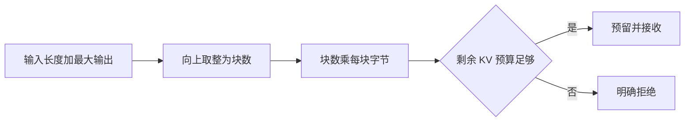

> [!NOTE] 生成演示
> 层数、头数与容量均为人工构造的参数。程序只计算普通全注意力单序列的示意载荷，不加载模型，不分配 GPU 内存，不预测任意具体设备的可服务并发数。

## “还剩很多显存”为什么不是准入规则

假设监控面板显示内存还有空余，新请求也成功进入队列，但生成到中途时却无法继续分配状态。这不一定意味着监控数字错误，可能只是接收时只计算了当前已经占用的部分，没有为后续增长留下可兑现的空间。资源预算需要覆盖你已经作出的承诺，而不仅是当前看见的分配。

这一章把 [[演示 · AI 工程 02｜用确定性负载看懂时延与吞吐]] 中的“最多两个任务”替换成一份显式账本。学习目标是从形状算字节，区分实际载荷与预留，再解释为什么计算正确也不等于能够直接部署。先修需要整数乘法、列表，以及上一章的准入概念。

我们选择一个便于计算的普通全注意力教学假设：每层为每个位置保存一组键和值，所有层采用相同的 KV 头数、头维度和每元素字节数；没有共享前缀、滑动窗口、压缩或跨设备切分。现实中的模型可能不满足这些条件，遇到混合结构时应逐层计算，不能继续使用同一个总乘法。

## 从一个位置开始，不急着算整台机器

先写形状，再写单位。一个位置在一层保存的元素数量是两份状态乘以 KV 头数，再乘每头维度；乘上层数和每元素字节数，就得到单位置载荷。这里必须使用 KV 头数，不能因为模型还有另一种头数就直接混用。

构造参数是三十二层、八个 KV 头、每头一百二十八个元素、每元素两个字节。于是单位置载荷为十三万一千零七十二字节，也就是一百二十八 KiB。二千零四十八个位置恰好是二百五十六 MiB。我们使用二进制单位，KiB 和 MiB 分别以一千零二十四为倍数，避免把十进制 MB 混入表格。

| 项目 | 本章假设 | 单位 |
| --- | ---: | --- |
| 键和值 | 2 | 份 |
| 层数 | 32 | 层 |
| KV 头数 | 8 | 头/层 |
| 头维度 | 128 | 元素/头 |
| 元素精度 | 2 | 字节/元素 |
| 单位置载荷 | 131072 | 字节/位置 |

这张表没有模型权重、临时激活、执行工作区、通信缓冲、运行时管理信息或内存分配器开销。因此它是 KV 载荷表，不是整机内存表。如果有人把最后一行乘以窗口以后直接从设备标称容量里扣除，就已经跨过了本章明确设定的边界。

## 位置预算还要经过块大小取整

假设分配器按十六个位置为一块管理状态，十七个位置就需要两块，预留三十二个位置的空间。多出的十五个位置不是已经产生的 token，而是分配粒度带来的剩余位置。请求越短、尾块越多，这种差别越容易被忽略。

分页式管理可以改变状态的组织与分配方式，但不会让每个已存储元素不再占空间。真实实现还有块表、共享引用与生命周期等条件。本文只保留向上取整这一步，让我们先看清“逻辑上需要多少”和“按粒度必须预留多少”的差别。



图中的预算是提前划给 KV 的一部分容量。它已经排除了权重和其他开销，不能再被命名为“设备总内存”。明确命名变量是一个很便宜的保护：如果代码把它叫 `kv_budget_bytes`，后面的维护者就更容易发现把整卡容量传进去是不完整的配置。

## 完整的整数预算器

这里采用保守预留：在接收时为输入与最大输出之和预留空间。真实系统也可以随生成逐步增长，但必须另行实现增长失败、抢占或回收策略；把预留改成当前长度而不补这些路径，不能算作优化。

代码文件：`kv_budget.py`；重点行：14-32

```python
def positive(value):
    if type(value) is not int or value <= 0:
        raise ValueError("positive integer required")
    return value

def bytes_per_position(layers=32, kv_heads=8, head_dim=128, width=2):
    return 2 * positive(layers) * positive(kv_heads) * positive(head_dim) * positive(width)

def reserved_bytes(inputs, max_output, block=16):
    positions = positive(inputs) + positive(max_output)
    block = positive(block)
    blocks = (positions + block - 1) // block
    return blocks * block * bytes_per_position()

def plan(requests, kv_budget_bytes):
    remaining = positive(kv_budget_bytes)
    decisions = []
    for inputs, output in requests:
        requested = reserved_bytes(inputs, output)
        accepted = requested <= remaining
        if accepted:
            remaining -= requested
        decisions.append((accepted, requested))
    return decisions, remaining

MiB = 1024 * 1024
assert bytes_per_position() == 131072
assert reserved_bytes(16, 1) == 4 * MiB
assert reserved_bytes(1024, 1024) == 256 * MiB
items, left = plan([(1024, 512), (1024, 512), (2048, 512)], 512 * MiB)
assert [accepted for accepted, _ in items] == [True, True, False]
assert left == 128 * MiB
assert sum(size for accepted, size in items if accepted) + left == 512 * MiB
for value in (0, -1, True, 1.5):
    try:
        reserved_bytes(value, 1)
    except ValueError:
        continue
    raise AssertionError("invalid size accepted")
print("bytes_per_position=131072")
print("reserved_MiB=[192, 192, 320] accepted=[True, True, False] free_MiB=128")
```

运行输出：

```text
bytes_per_position=131072
reserved_MiB=[192, 192, 320] accepted=[True, True, False] free_MiB=128
```

最后一个请求被拒绝后，剩余预算仍然是一百二十八 MiB。拒绝不应该消耗预留，也不能留下“半个接收”的状态。这里用守恒断言验证接收项预留之和加剩余空间等于初始容量；在真实多线程程序中，这组检查和扣减必须处于同一个受保护的操作中。

## 三种看起来合理却不完整的推断

第一种是“输出通常很短，所以只按平均输出预留”。平均值描述历史分布，不能保证下一次请求不触及上限。如果准入依据平均值，就必须明确它是统计超售策略，同时设计超出预算时的行为和风险目标。不能同时宣称按平均值省资源，又承诺每个已接收请求都能达到最大输出。

第二种是“缓存命中了，所以这次不占 KV”。共享状态可能减少重复保存，但共享的对象仍然存在，引用关系也需要维护。取消一条请求不能直接删除仍被其他请求使用的共享块。共享节省应由实际引用与分配记录支持，而不是把所有有相同开头的文本都当作相同已编码前缀。

第三种是“用了多张设备，把总数平均除一下就好”。切分方式、复制的数据、流水阶段和通信缓冲都会改变每台设备的负担。单设备上最紧张的一项约束可能先触发，集群总空余再多也无法自动填补。因此这份账本最多作为未切分载荷的起点，不能替代引擎的每设备实测。

预算还需要标记测量时点。空闲进程的余量、加载权重之后的余量，以及一次预热之后的余量可能不同。实验记录应写明在哪个阶段读取，是否包含尚未释放的临时分配，以及哪些请求仍在运行。只有时点一致，两个容量数字才具备可比较的含义；公式上的整数精确不能弥补观察条件缺失。

```recall
{"question":"为什么算出了 KV 载荷，仍然不能直接给出整台机器的安全并发数？","answer":"载荷公式只覆盖假定形状的键和值；还缺少权重、工作区、运行时开销、分块预留与每设备分配约束。必须先确认这些条件和真实测量时点，再定义可兑现的准入预算。"}
```

## 实践：把估算变成可审核的容量说明

先把第二个请求的最大输出从五百一十二改成一千零二十四，重新预测剩余空间；再把块大小从十六改成三十二，找出哪些输入会变化、哪些不会变化。提示是观察总位置能否整除块大小，而不是机械地把所有结果翻倍。

交付物应包含两张表：一张列出公式假设、数据来源与单位，另一张列出接收顺序、单项预留、剩余容量与拒绝原因。再添加一个反例，说明当前方法无法处理滑动窗口或多设备切分中的哪一项。能够说清不适用的地方，比给出一个看起来很精确的并发数更可靠。

最后思考释放路径：正常完成会释放预留，排队取消也要释放，执行失败同样如此。若取消事件重复送达，释放不能重复发生。下一章 [[演示 · AI 工程 04｜把准入、轮转与取消放进同一张状态图]] 会把这份静态预算接到实际状态变化上。

## 来源与边界

不同缓存策略的适用条件可阅读 [Hugging Face 缓存说明](https://huggingface.co/docs/transformers/main/kv_cache)；块组织的实现背景可阅读 [vLLM Paged Attention 设计](https://docs.vllm.ai/en/stable/design/paged_attention/)。本文没有复现其内核，也没有假定所有模型采用同一种缓存形状；整数算例与参数均为独立教学设计。
