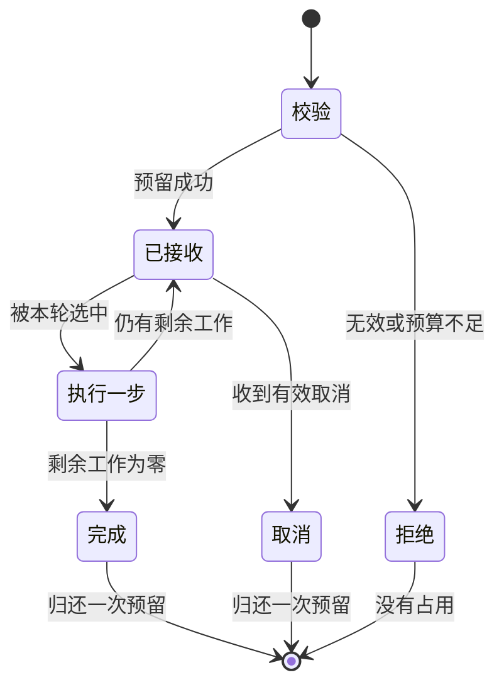

> [!NOTE] 生成演示
> 本文的批次只是每轮选择若干任务的逻辑集合，不执行 GPU kernel，不实现真实预填充或连续批处理引擎。每轮成本是构造单位，不表示不同任务耗时相等。

## 请求被接受以后，服务究竟欠了什么

上一章 [[演示 · AI 工程 03｜给 KV 状态写一份有边界的内存账本]] 只决定能否预留资源。真正运行起来以后，还要维护一项更难的约束：任何时刻，已接收任务、占用资源和终态记录必须对得上。一个已经取消的任务如果仍占着预算，表现可能与容量不足完全一样；一个重复完成事件如果释放两次，下一次准入就可能超出真实容量。

这一章的目标是把准入、执行一步、完成与取消放进同一个小状态机。先修是字典或元组的基本操作，以及上一章的守恒式。完成后，你应当能够解释一次取消到底改变了什么，为什么重复取消不能继续增加可用容量，以及为什么“每轮选两项”本身不能证明吞吐翻倍。

我们继续使用预留制：接收时占用固定资源，直到任务进入终态才归还。为了让例子简洁，资源单位叫“格”，不叫显存字节。真实应用可以用上一章的字节预算替代格数，但不能省掉完成与取消时的核对步骤。

## 用终态收紧所有退出路径

正常完成、取消和执行失败都应终结一次尝试，但它们不是相同的业务结果。对资源管理而言，关键是同一个任务只结束一次。我们把已结束标识保留下来，后续相同标识不能被当作全新的任务再次接收。这只是进程内示例的防重复逻辑，不是永久幂等服务，也没有处理进程重启后的恢复。



图中没有“已释放但继续执行”的状态。真实系统中，取消信号送达和设备上的工作停止可能存在延迟，这时需要增加“正在停止”的中间状态，并在确认执行单元不再使用资源后才回收。本文是单线程离散步骤模型，所以可以在步骤之间立即取消；这一简化必须和实现一起说明。

## 批处理首先是一条选择规则

每一轮选择最前面的两项任务，各完成一个工作单位。未选中的任务继续等待，选中过但未结束的任务放到队尾。这样实现的是一个简单轮转规则：在任务数量有限、每项单步能结束的前提下，等待中的任务最终能被选到。它没有按输入长度、优先级、截止时间或设备成本做优化。

真实推理中的批处理还必须满足张量布局、内存预算和执行形状等条件。预填充与生成也不一定适合用相同的调度粒度。把它们都画成一个方框很方便，但如果要进一步解释首响和输出间隔，就需要恢复这些差别。本章只关注任务集合变化与资源守恒，为后续复杂策略提供可测试的底座。

| 事件 | 活跃任务 | 占用格数 | 解释 |
| --- | --- | ---: | --- |
| 接收 A、B | A、B | 7 | A 占 4，B 占 3 |
| 尝试接收 C | A、B | 7 | C 需要 4，预算不足 |
| 第一轮结束 | A、B | 7 | 两项都还没有完成 |
| 取消 A | B | 3 | 只归还 A 的 4 格 |
| 再次接收 C | B、C | 7 | 拒绝过不等于已经执行过 |
| 第二轮结束 | 无 | 0 | B 与 C 都完成 |

表格故意让拒绝后的 C 可以再次提出请求，但保留同一个教学名称。真实客户端是否允许这么做，需要由幂等键和尝试标识的协议决定，不能把这里的便利操作直接当成通用重试约定。

## 用不可变状态写一个小调度器

每次操作都返回新的状态对象，旧状态不变，方便比较事件前后的账本。`used` 从活跃任务求和，避免同时维护一个可能漂移的可用计数器。真实高性能调度器可能使用增量计数，但仍应保留独立的校验途径。

代码文件：`scheduler.py`；重点行：30-43

```python
from dataclasses import dataclass

@dataclass(frozen=True)
class Job:
    name: str
    remaining: int
    reserved: int

@dataclass(frozen=True)
class State:
    budget: int
    jobs: tuple = ()
    terminal: tuple = ()

def used(state):
    return sum(job.reserved for job in state.jobs)

def admit(state, job):
    if (not job.name or type(job.remaining) is not int or job.remaining < 1
            or type(job.reserved) is not int or job.reserved < 1):
        raise ValueError("invalid job")
    names = {item.name for item in state.jobs} | set(state.terminal)
    if job.name in names or used(state) + job.reserved > state.budget:
        return state, False
    return State(state.budget, (*state.jobs, job), state.terminal), True

def tick(state, width=2):
    if type(width) is not int or width < 1:
        raise ValueError("invalid batch width")
    selected, waiting = state.jobs[:width], state.jobs[width:]
    remaining = tuple(Job(job.name, job.remaining - 1, job.reserved)
                      for job in selected if job.remaining > 1)
    finished = tuple(job.name for job in selected if job.remaining == 1)
    return State(state.budget, (*waiting, *remaining), (*state.terminal, *finished))

def cancel(state, name):
    if not any(job.name == name for job in state.jobs):
        return state, False
    return State(state.budget, tuple(job for job in state.jobs if job.name != name),
                 (*state.terminal, name)), True

initial = State(7)
one, ok = admit(initial, Job("A", 3, 4))
assert ok and not initial.jobs
two, ok = admit(one, Job("B", 2, 3))
assert ok and used(two) == 7
blocked, ok = admit(two, Job("C", 1, 4))
assert not ok and blocked == two
after_tick = tick(two)
after_cancel, ok = cancel(after_tick, "A")
assert ok and used(after_cancel) == 3
same, ok = cancel(after_cancel, "A")
assert not ok and same == after_cancel
three, ok = admit(after_cancel, Job("C", 1, 4))
assert ok
finished = tick(three)
assert not finished.jobs and used(finished) == 0
assert set(finished.terminal) == {"A", "B", "C"}
assert not admit(finished, Job("A", 1, 1))[1]
print("initial_used=7 after_cancel=3 final_used=0 terminal=3")
```

运行输出：

```text
initial_used=7 after_cancel=3 final_used=0 terminal=3
```

本例中取消和完成共享终态集合，所以不能从终态集合判断业务成功率。若要做监控，必须额外保存终止原因；下一章会把取消、错误和重试区分开。这也展示了一条重要边界：足以证明资源安全的数据结构，不一定足以回答用户体验问题。

## 哪些失败要通过测试提前暴露

首先检查预算不足时没有副作用。`admit` 返回失败后，活跃任务列表和终态列表都应该保持原样。其次检查重复取消：它返回未改变状态，而不是再次给可用容量加四。最后检查同一标识在终态后重新提交：本章拒绝它，防止一次尝试被不小心复活。

还应该检查公平性。把宽度设为一，再加入三项剩余量不同的任务，记录每轮名字顺序。如果一直选择列表开头却不轮转，后面的任务可能等到前面的长任务完整结束；如果轮转后丢掉未选中的项，就会发生悄悄丢任务。两种错误都可能通过“最终没有异常”的肤浅测试。

资源释放不能只依赖正常返回。真实执行调用如果抛出异常，必须经过统一的收尾路径；如果进程崩溃，需要由外部生命周期和恢复机制处理，而不是期待 `finally` 在所有故障下都会执行。本文没有实现崩溃恢复，所以结果只证明当前进程的已建模路径。

状态机还提供一个排查入口：若可用资源持续减少，先按任务标识核对接收和终态是否一一对应，再检查分配器。若日志有完成而预算未归还，问题可能在收尾；若预算归还但执行单元还在引用资源，问题可能在取消确认。先定位状态边界，再讨论增大容量，可以避免用更多资源暂时遮住同一个漏洞。

```recall
{"question":"为什么客户端取消以后，服务端不能总是立刻释放请求占用的内存？","answer":"停止等待与执行单元停止使用内存是不同事件。真实执行可能仍在运行，必须等取消确认或安全结束后回收。本文只在单线程模拟步骤之间取消，因此允许立即释放。"}
```

## 实践：为调度策略留下可以解释的证据

交付物是一张逐轮状态表，记录活跃顺序、每项剩余工作、资源占用和结束原因。先把批次宽度改成一，再加入一项需要五步的长任务，预测短任务何时结束。不要只比较总轮数；同时检查短任务等待与任务之间是否存在饥饿。

再添加一个“执行失败”的操作：它应终止指定任务，归还资源，并留下区别于成功的原因。提示是复用取消的资源路径，但不要复用其业务标签。最后写一个断言，对任何已构造状态验证占用始终处于零到预算之间，而且同一名字不会同时处于活跃和终态。

如果已经理解这张状态图，再阅读真实调度器时，可以先找任务加入、单轮选择、抢占、取消和资源回收五条路径。代码再复杂，这些责任也需要有明确归属。下一章 [[演示 · AI 工程 05｜把重试关进总时间和次数预算]] 将从调用者角度解释为什么重试会放大调度压力。

## 来源与边界

真实引擎的缓存块和执行约束可从 [vLLM Paged Attention 设计](https://docs.vllm.ai/en/stable/design/paged_attention/)继续追踪，过载背景可参考 [Google SRE：处理过载](https://sre.google/sre-book/handling-overload/)。这里的不可变状态、轮转程序与所有格数都是本文独立设计，不是对任何引擎性能或实现细节的复刻。
