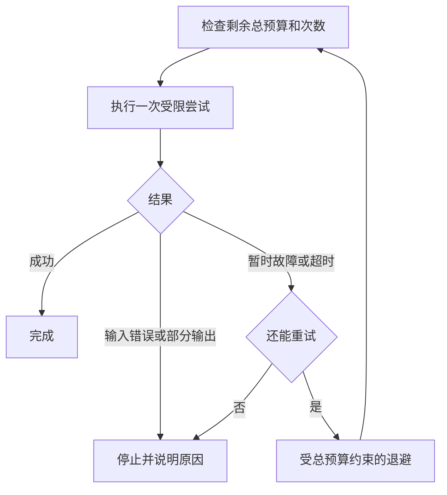

> [!NOTE] 生成演示
> 本章用整数表示构造时间，不访问网络、不休眠、不执行实际重试。示例中的错误分类与固定退避用于解释约束，不是可直接用于真实服务的重试库。

## “再试一次”为什么可能让故障扩大

一个请求没能及时返回，最直观的做法是再发一次。但第一个请求可能仍然在后端运行，第二个请求又进入了同一条拥挤的队列。调用者看见的是一次恢复动作，服务端承受的却可能是两份工作。若每一层都自动重试，最终执行次数还会继续相乘。

上一章 [[演示 · AI 工程 04｜把准入、轮转与取消放进同一张状态图]] 解决了已接收任务的资源释放。本章转向调用者：什么时候还值得发起下一次尝试，什么时候应明确停止。学习目标是把总截止点、单次上限和次数预算同时写进代码，并解释为什么收到过部分输出以后，不能随意从头重试再拼接结果。

先修是函数和条件分支，不需要真实网络。完成本章的交付物是一张尝试时间线，能说明每次开始与结束、等待了多久、还剩多少预算，以及最终为什么停止。仅有“最大重试三次”不足以回答这些问题，因为每次等待时长仍可能没有上界。

## 总截止点是所有阶段共用的一本账

设一个逻辑请求从时间零开始，最多允许十个构造单位。第一次尝试花三单位后发生暂时故障，退避两单位，第二次尝试从五开始，再花四单位成功，因此总时长为九。若总预算只有七，第二次最多只能再占两单位，不能因为它是一次新的尝试就重新获得完整预算。

队列等待、连接建立、发送、读取和退避是否全部包含在总预算内，必须由接口明确。某些客户端库的一个“超时”参数只覆盖部分阶段；只看参数名字无法得出完整结论。在真实集成中，应逐个核对传输库的含义，使用服务端可信的单调时间计算剩余跨度。

| 约束 | 回答的问题 | 单独存在时遗漏什么 |
| --- | --- | --- |
| 总截止点 | 整个逻辑请求还能等多久 | 不限制瞬间重试数量 |
| 单次上限 | 某次尝试最多占多久 | 多次尝试可能累积过长 |
| 次数预算 | 最多发出几次请求 | 每次可能等待很久 |
| 退避规则 | 失败后何时再试 | 不保证操作安全或容量足够 |

四项约束需要一起判断。退避可以降低重试的密集程度，但不能创造后端容量；取消可以让调用者停止等待，但不能证明后端立即停止计算。系统必须把这些信号继续传递到真实执行边界，否则只是在界面上结束了一个仍消耗资源的任务。

## 哪些故障值得考虑重试

首先排除确定性的输入错误。上下文超出上限、字段类型错误或权限不足，不会因为立即重发而自然修复。其次判断操作是否具备可接受的重复语义。即使生成接口看起来只返回文本，也可能消耗计费额度、记录审计事件或触发下游工具，因此不能仅凭 HTTP 方法或一个模糊错误码推断安全。

本例约定 `transient` 是可重试的暂时故障，`invalid` 不可重试，`partial` 表示在本次允许的执行窗口内已经向用户返回过部分内容，必须停止自动重试。`partial` 是已观察到的事实，不是对未来输出的预测；即使随后触及单次上限或总截止点，也不能把这个事实改写成可以重试的普通超时。这不是通用错误码，而是显式的教学分类。实际系统应根据接口契约制定规则，并在收到明确的服务端等待建议时尊重其边界。



在真实环境里，抖动用于避免大量调用者在完全相同的时刻重试。本文采用固定两单位退避，只是为了让所有读者能得到同一条时间线。可以在后续扩展中使用有明确种子的伪随机序列测试抖动范围，但不能把一次构造轨迹当作真实群体流量分布。

## 完整的预算模拟器

下面的程序把潜在结束时长和结果写在输入里，所有时长仍是构造工作单位。单次上限或剩余总预算不足时，普通结果变成超时，不再直接相信原本的成功标签；已知送达过内容的 `partial` 则变成不可重试的 `partial_timeout`，同时保留“已有输出”和“后来超时”两件事。模型不计算首个片段的时刻，因此调用方只能把已经在允许窗口内送达内容的尝试标为 `partial`，不能拿尚未发生的输出作输入。这里假定超时可以立即终止教学尝试；真实后端如果继续工作，需要另一个账本计算重复占用。

代码文件：`retry_budget.py`；重点行：18-35

```python
def simulate(outcomes, deadline=10, per_attempt=5, max_attempts=3, backoff=2):
    if any(type(v) is not int or v < 1 for v in (deadline, per_attempt, max_attempts)):
        raise ValueError("invalid positive budget")
    if type(backoff) is not int or backoff < 0:
        raise ValueError("invalid backoff")
    if not outcomes or any(type(d) is not int or d < 1 or
            kind not in {"ok", "transient", "invalid", "partial"}
            for d, kind in outcomes):
        raise ValueError("invalid outcomes")
    now, trace = 0, []
    for number, (duration, kind) in enumerate(outcomes[:max_attempts]):
        if now >= deadline:
            return "deadline", trace
        allowed = min(per_attempt, deadline - now)
        elapsed = min(duration, allowed)
        if duration <= allowed:
            observed = kind
        else:
            observed = "partial_timeout" if kind == "partial" else "timeout"
        trace.append((number + 1, now, now + elapsed, observed))
        now += elapsed
        if observed == "ok":
            return "ok", trace
        if observed in {"invalid", "partial", "partial_timeout"}:
            return observed, trace
        if now >= deadline:
            return "deadline", trace
        if number + 1 >= max_attempts:
            return "attempt_budget", trace
        if number + 1 >= len(outcomes):
            return "trace_exhausted", trace
        if now + backoff >= deadline:
            return "no_retry_window", trace
        now += backoff
    return "attempt_budget", trace

success, trace = simulate([(3, "transient"), (4, "ok")])
assert success == "ok" and trace[-1] == (2, 5, 9, "ok")
limited, short_trace = simulate([(3, "transient"), (4, "ok")], deadline=7)
assert limited == "deadline" and short_trace[-1] == (2, 5, 7, "timeout")
for kind in ("partial", "invalid"):
    result, events = simulate([(1, kind), (1, "ok")])
    assert result == kind and len(events) == 1
partial_timeout, partial_trace = simulate([(6, "partial"), (1, "ok")], deadline=20)
assert partial_timeout == "partial_timeout" and partial_trace == [(1, 0, 5, "partial_timeout")]
partial_deadline, deadline_trace = simulate([(6, "partial"), (1, "ok")], deadline=4)
assert partial_deadline == "partial_timeout" and len(deadline_trace) == 1
assert simulate([(1, "transient")] * 3, max_attempts=2)[0] == "attempt_budget"
assert simulate([(4, "transient"), (1, "ok")], deadline=6)[0] == "no_retry_window"
assert all(end <= 10 and end >= start for _, start, end, _ in trace)
print("normal: result=ok attempts=2 finished_at=9")
print("short_budget: result=deadline attempts=2 finished_at=7")
print("partial_output: automatic_retry=False")
print("partial_timeout: automatic_retry=False attempts=1 finished_at=5")
```

运行输出：

```text
normal: result=ok attempts=2 finished_at=9
short_budget: result=deadline attempts=2 finished_at=7
partial_output: automatic_retry=False
partial_timeout: automatic_retry=False attempts=1 finished_at=5
```

本例选择“恰好在截止点完成算成功”。如果你的协议要求严格早于截止点，应修改比较符号并为相等边界单独补测试。看似很小的选择，会影响超时比例与用户可见结果，所以不应只藏在一行代码里。

## 部分输出与幂等键不能混为一谈

想象第一条流已经输出一句话，随后连接中断。重新发起生成，第二次可能得到不同文本，即使最终完整返回，也不能直接接在第一句后面，假装它们来自同一次连续生成。安全的界面可以明确标记中断，并由用户选择重新开始；支持断点续传则需要服务端有对应的稳定状态协议。

幂等键同样不是一个能自动解决所有问题的字符串。服务必须定义键的有效期、与请求内容的绑定、处理中与完成后的响应，以及重复提交发生冲突时的行为。两个不同的输入不应因为误用同一个键而悄悄获得旧结果。本文只模拟尝试预算，没有实现服务端幂等存储。

还要防止重试层叠。若入口尝试三次、内部客户端再尝试三次，最坏情况下后端可能承受九次调用。应明确由哪一层负责恢复，并让总次数或总工作预算跨层传播。对已经过载的服务，停止发送可能比坚持重试更接近恢复目标。

```recall
{"question":"总时间预算和最大尝试次数为什么需要同时存在？","answer":"次数上限不能限制一次尝试等待多久；总时间上限也不能防止短时间发出大量请求。还需要单次上限和受总预算约束的退避，并单独判断操作是否允许重复。"}
```

## 实践：写出停止理由

把总预算设为六，第一次故障发生在四，退避仍为二，预测程序是否会发起第二次。提示：退避后没有任何正的执行窗口，因此结果是“没有重试窗口”，而不是发出一个必然超时的新请求。再把第一次结果改成部分输出，确认不论剩余预算有多少，都不会自动继续。最后测试潜在时长六、单次上限五、总预算二十且窗口内已经送达片段的尝试：它应在五终止为 `partial_timeout`，只尝试一次；把总预算进一步改成四，也不能重试。

交付物是一份表格，列出尝试序号、开始、结束、观察结果、剩余预算和停止原因。为每一种停止原因给一个最小输入；如果两个原因无法区分，检查是不是把异常过早压成了同一个字符串。最后说明你的模拟没有覆盖网络中断后仍在执行的重复工作。

将这份表和 [[演示 · 超时与重试：先限制总预算，再决定是否再试]] 对照，可以把通用网络约束接回推理场景。下一章 [[演示 · AI 工程 06｜用一份事件账本交付完整服务实验]] 会把前面的计数、状态与时间线汇总成能够审阅的实验报告。

## 来源与边界

超时、重试和退避的工程背景可阅读 [AWS Builders’ Library：Timeouts, retries, and backoff with jitter](https://aws.amazon.com/builders-library/timeouts-retries-and-backoff-with-jitter/)。本文的预算算法、错误标签和所有事件均为独立构造；真实接入仍需核对客户端库的超时覆盖范围与服务端幂等协议。
