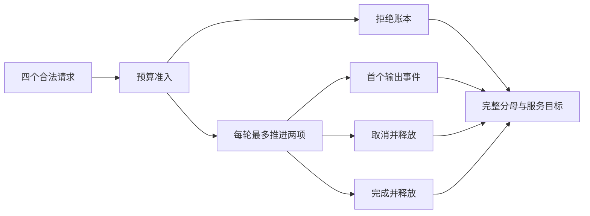

> [!NOTE] 生成演示
> 本文交付的是有界离散服务模型和实验报告，不是生产推理服务器。每步、内存格数和服务目标均为构造值；不依赖 GPU、网络、云服务或付费 API。

## 最后一个任务：让别人能够审阅你的结论

前面已经分别讨论了请求契约、负载、状态预算、调度和重试。现在需要把它们收拢成一个能够被检查的实验。交付物不是一张写着“优化百分之多少”的图，而是一份解释输入、假设、事件、结果与局限的记录。另一位读者应能复制程序，得到同样的数值，并指出改变某个假设会影响哪些结论。

本章先修是前五章，尤其是 [[演示 · AI 工程 04｜把准入、轮转与取消放进同一张状态图]] 的资源守恒，以及 [[演示 · AI 工程 05｜把重试关进总时间和次数预算]] 的尝试边界。这里不重复实现所有协议层，而是使用四个已经合法的教学任务，观察从到达到终止的全过程。

我们让服务最多预留七格资源，每轮最多推进两项任务，每项被选中时完成一步。A 在零时刻到达，需要三步、四格；B 在一时刻到达，需要两步、三格；C 同时到达，需要一步、四格；D 在三时刻到达，需要一步、四格。B 在二时刻取消。输入刻意同时覆盖成功、部分输出后的取消和容量拒绝。

## 先写同刻事件顺序，再看图

本模型每个整数边界先处理取消，再处理新到达，最后选择任务推进到下一个边界。上一步产生的首个输出与完成事件已经记录在当前边界。这个顺序使 B 可以在得到过一次输出以后被取消，也使 A 在三时刻释放资源后，D 能在同一时刻被接收。

如果不写顺序，时间二的取消究竟发生在 B 的下一步之前还是之后就会变得含糊，终态也可能从取消变成成功。同刻规则是模型定义的一部分，不能等看到喜欢的结果以后再补。真实系统通过并发控制定义可观察顺序，实验程序则可以把它直接写成步骤。



图中的“首个输出”是模型中完成第一步产生的教学输出，不等于真实 token 测量。本文没有对事件做网络编码，也没有模拟客户端缓冲。真实流式调用应分别定义服务端生成时间与客户端接收时间，两者都重要，但不能互相替换。

## 最小实现：一份事件记录支撑多项检查

代码每次保存一个事件元组，结构是请求名、事件名和时间。它不记录提示词或用户身份，只保存重建教学过程所必需的信息。这个日志仅有四个请求，因此可以直接检查；真实系统需要有采样、容量和保留策略，不能无限积累逐请求事件。

代码文件：`capstone.py`；重点行：26-47

```python
from dataclasses import dataclass

@dataclass(frozen=True)
class Task:
    name: str
    arrival: int
    steps: int
    cost: int

def serve(tasks, cancellations, budget=7, width=2):
    if type(budget) is not int or budget < 1 or type(width) is not int or width < 1:
        raise ValueError("invalid capacity")
    if len({task.name for task in tasks}) != len(tasks):
        raise ValueError("duplicate request")
    if any(not task.name or type(task.arrival) is not int or task.arrival < 0
           or type(task.steps) is not int or task.steps < 1
           or type(task.cost) is not int or task.cost < 1 for task in tasks):
        raise ValueError("invalid task")
    active, events, started = (), (), frozenset()
    horizon = max((task.arrival for task in tasks), default=0) + sum(t.steps for t in tasks) + 1
    for now in range(horizon):
        cancelled = tuple(t for t in active if t.name in cancellations.get(now, ()))
        events += tuple((t.name, "cancelled", now) for t in cancelled)
        active = tuple(t for t in active if t not in cancelled)
        for task in (t for t in tasks if t.arrival == now):
            events += ((task.name, "arrived", now),)
            if sum(t.cost for t in active) + task.cost > budget:
                events += ((task.name, "rejected", now),)
            else:
                active += (task,)
                events += ((task.name, "accepted", now),)
        selected, waiting = active[:width], active[width:]
        for task in selected:
            if task.name not in started:
                events += ((task.name, "first", now + 1),)
                started = started | {task.name}
            if task.steps == 1:
                events += ((task.name, "completed", now + 1),)
        active = waiting + tuple(Task(t.name, t.arrival, t.steps - 1, t.cost)
                                 for t in selected if t.steps > 1)
        assert 0 <= sum(t.cost for t in active) <= budget
    assert not active
    return events

def report(events, target=2):
    names = {name for name, _, _ in events}
    records = []
    for name in sorted(names):
        rows = [(kind, at) for item, kind, at in events if item == name]
        kinds = [kind for kind, _ in rows]
        if len(set(kinds)) != len(kinds) or rows[0][0] != "arrived":
            raise ValueError("duplicate or missing event")
        if [at for _, at in rows] != sorted(at for _, at in rows):
            raise ValueError("time moved backwards")
        values = dict(rows)
        ends = [kind for kind in ("completed", "cancelled", "rejected") if kind in values]
        if len(ends) != 1 or (ends[0] == "rejected") == ("accepted" in values):
            raise ValueError("invalid terminal state")
        if "completed" in values and "first" not in values:
            raise ValueError("completed without output")
        records.append((ends[0], values[ends[0]] - values["arrived"]))
    completed = sum(kind == "completed" for kind, _ in records)
    good = sum(kind == "completed" and elapsed <= target for kind, elapsed in records)
    return len(records), completed, good

work = (Task("A", 0, 3, 4), Task("B", 1, 2, 3),
        Task("C", 1, 1, 4), Task("D", 3, 1, 4))
events = serve(work, {2: ("B",)})
assert report(events) == (4, 2, 1)
assert ("B", "first", 2) in events and ("B", "cancelled", 2) in events
assert ("C", "rejected", 1) in events
for invalid in (events + (("A", "completed", 3),),
                tuple((n, k, -1 if n == "A" and k == "first" else t) for n, k, t in events)):
    try:
        report(invalid)
    except ValueError:
        continue
    raise AssertionError("invalid ledger accepted")
print("submitted=4 completed=2 cancelled=1 rejected=1")
print("within_target=1 target=2 good/submitted=25% good/completed=50%")
print("duplicate_terminal=rejected backwards_time=rejected resources_released=True")
```

运行输出：

```text
submitted=4 completed=2 cancelled=1 rejected=1
within_target=1 target=2 good/submitted=25% good/completed=50%
duplicate_terminal=rejected backwards_time=rejected resources_released=True
```

运行器只接收本文固定的小输入；`report` 的检查也不是通用的事件协议验证器。它能够抓住本次关注的重复终态与时间倒退，不能替代完整的消息乱序、重放、丢失和跨进程恢复设计。给验证器写清覆盖范围，可以避免把几个通过的断言误当成所有路径都已经证明。

## 同一个结果，两个分母

四个提交中，两项成功、一项取消、一项拒绝；成功率为二分之一。若只查看成功请求，其中一项在两单位目标内完成，所以成功样本内的达标率也是二分之一。但从所有提交看，只有四分之一既成功又足够快。两种计算都可以有用途，前提是分母在名字与说明里明确出现。

是否把用户主动取消计入服务失败，需要由服务目标定义。本章为教学保守地把所有提交作为机会总数，不声称这是任何业务必须采用的 SLO。实际报告可以同时给出完整分类，再说明哪些请求被纳入目标，避免通过静默删除“不好看”的类别制造改善。

同样，首响不能只挑成功样本里最早的一项。B 已经看见输出却随后被取消，这个事件对理解用户体验有价值，但不应混入“完整回答成功”的计数。把时间线按请求关联起来，比堆叠几条互不相干的平均值更容易发现这种差别。

## 从事件账本提取少量有用信号

先关心请求量、各终态数量、端到端时延以及资源占用。这些信号分别回答负载来了多少、结果如何、用户等了多久、系统还承受多少。必要时再拆出排队和首响，解释时延来自哪里。不要一开始就为每个请求标识创建一组指标标签；关联标识适合事件追踪，指标标签需要有限的取值集合。

在真实引擎里，还应核对每个指标的定义、单位和统计边界。名称里出现“token”不代表计数一定覆盖你关心的所有阶段，名称里出现“latency”也不能说明是否包含队列。文档与实际版本的暴露项需要一起核实，升级时也要保留定义变化记录。

本章不生成告警。四个教学请求不足以推导可靠的阈值、窗口或误报率。可以先用它设计一个需要调查的条件，例如资源占用长时间不回落，再在真实环境中根据容量、请求分布和服务目标验证。告警的作用是引导行动，不能只因为某条曲线能画出来就通知人。

```recall
{"question":"四个提交中两个完成，只有一个按时完成，按时率究竟是多少？","answer":"必须说明分母：按时完成占全部提交是25%，占成功完成是50%。两者描述不同条件；完整报告应保留取消与拒绝分类，并明示服务目标纳入哪些请求。"}
```

## 实践：交付一份可以被反驳的报告

先保持输入不变，把预算从七改成十一，预测 C 是否会被接收，以及它将在哪一轮执行。然后把批次宽度改为一，观察成功请求的时间线变化。每次只改一项，保留原始事件与输出；如果同时改三项，就很难解释最终变化由哪个条件导致。

再做两次故障注入：追加重复完成事件，把一个首响时间改到到达之前。程序应明确拒绝这两份账本。提示是验证器失败并不代表服务执行失败，而是观测证据不足以支持报告。不要为了继续出图而自动去重或把负时延改成零，否则会掩盖真正需要修复的问题。

最终报告包含六部分：问题、工作负载、规则与预算、原始事件、带分母的结果、适用边界。提出一个下一步假设，例如“提高预算能降低拒绝，但未必降低每项等待”，并设计足以推翻它的输入。完成实践标记应在你交付并检查这份报告后选择；读到页面底部不自动等于已经能够独立实验。

这条路线到这里形成了闭环：从 [[演示 · AI 工程 01｜把一次生成请求变成可验证的契约]] 的输入边界，到资源承诺、任务结束和最终证据。接下来可以把模型的一处假设替换成真实观测，但一次只替换一处，并保留其余条件，逐步把离线理解迁移到你自己的工程环境。

## 来源与边界

监控信号的组织背景可阅读 [Google SRE：监控分布式系统](https://sre.google/sre-book/monitoring-distributed-systems/)；真实推理服务指标的定义可核对 [vLLM Production Metrics](https://docs.vllm.ai/en/stable/usage/metrics/)。本文的事件协议、目标窗口、模拟服务和全部数值均为原创教学设计，没有宣称执行过真实引擎基准测试。
