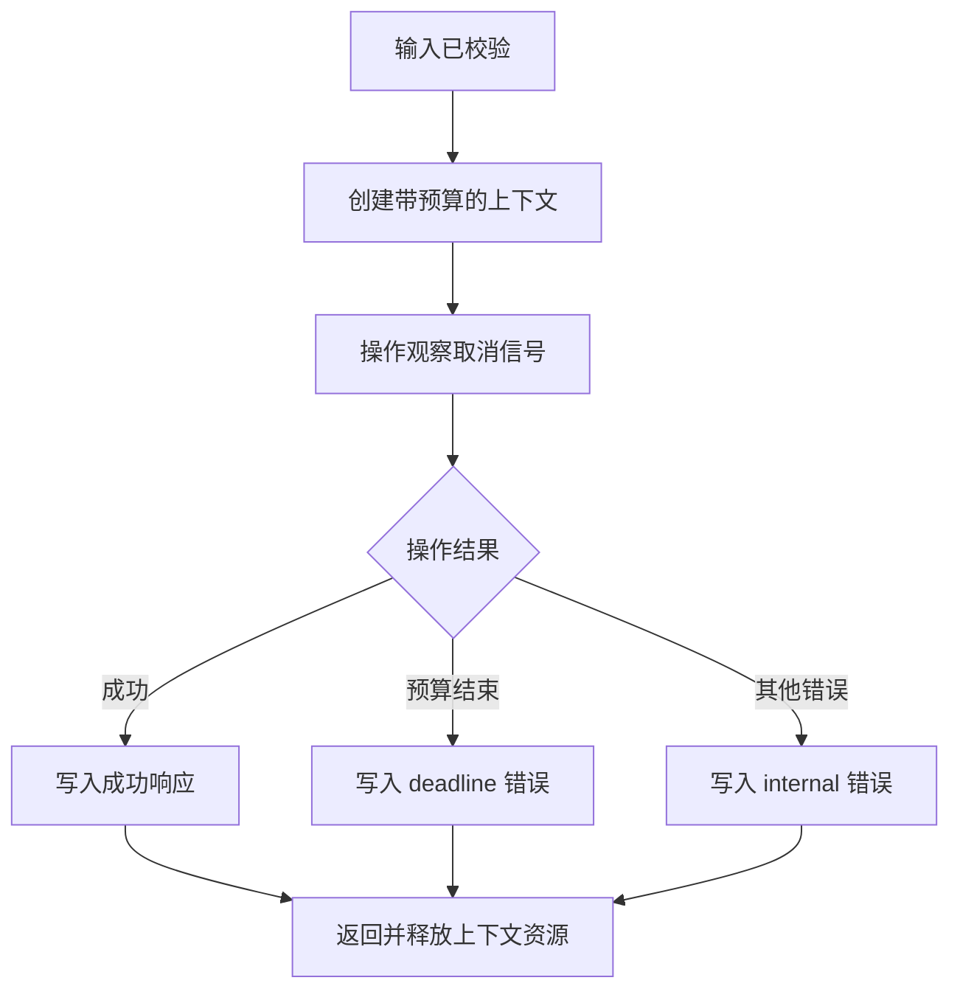

> [!NOTE] 这是一份可以运行的生成演示
> 场景和输入均为教学构造，不是作者的生产经历。完整程序只使用 Go 标准库；本文的验证直接调用处理器，不开启监听端口、不访问外部服务。

## 一个看起来太简单的请求

设想浏览器发来 `GET /greet?name=asher`。你希望它得到一份 JSON：状态成功，消息是 `hello, asher`。这件事看起来只需要拼接一个字符串。可一旦把输入换成空名字、重复参数，或者让处理过程一直不结束，程序究竟该回复什么？这些分支决定了一个接口是否真正有清晰的约定。

本文沿着同一条请求往前走，不在每章换一个无关例子。你会看到输入怎样变成可靠的值，业务逻辑怎样接收取消信号，错误怎样被翻译成 HTTP 响应，以及测试怎样证明它们没有混在一起。读完以后，你应该能在任意一个小型 Go 服务里画出类似的请求路径，而不仅仅是复制一个能返回成功的处理函数。

先修知识不多：能读懂函数、结构体、`if` 和 `error` 即可。不熟悉函数返回值时，可以先看 [[演示 · Go 07｜函数：把重复逻辑变成明确约定]]。本文里的 `context` 和处理器抽象会在用到时解释，不要求你提前学会并发框架。

先在下面选择正常、无效或超时情形，再逐步观察停在哪一层。这个组件解释控制流程，不向你的服务器发送请求；真正的可执行证据来自后文的 Go 测试。

```explore
{"kind":"go-request","title":"跟随一条请求，逐步找到失败位置"}
```

## 先约定边界，再写成功路径

一个便于练习的最小接口约定如下。名字最多三十二个 Unicode 码点，不允许空白名字、重复名字或其他查询字段；接口只处理指定路径上的 GET。这里故意不做身份认证、数据库查询和图片上传，因为那些能力会掩盖这次要观察的输入边界。

| 输入或情形 | 本例期望 | 处理停止的位置 |
| --- | --- | --- |
| `GET /greet?name=asher` | 200，`ok=true` | 正常写入消息 |
| `GET /greet?name=` | 400，`bad_input` | 名字校验 |
| `GET /greet?name=a&name=b` | 400，`bad_input` | 参数数量校验 |
| `POST /greet?name=asher` | 405，并带 `Allow: GET` | 方法检查 |
| `GET /other?name=asher` | 404，`not_found` | 路径检查 |
| 处理操作耗尽本地预算 | 503，`deadline` | 错误映射 |
| 未知的处理错误 | 500，`internal` | 错误映射 |

状态码是一份对外约定，不是对所有应用的通用结论。例如，本例没有代理任何上游服务，本地操作预算耗尽时选用服务不可用，而不是把它包装成网关超时。你可以为自己的接口选择其他合适策略，但必须同时修改说明、调用方和测试。


这张图的文字等价是：请求先经过入口约束，只有输入合法才进入处理阶段；处理结束后，统一转换成响应。校验失败不会继续执行问候操作。把顺序画出来，会比一开始就塞进很多日志更容易发现职责交叉。

## 处理器不是整台服务器

Go 的 HTTP 处理器接收请求和响应写入器。你可以把请求想成读入的一张单据，把写入器想成只能按协议填写的回执。处理器负责完成这张回执；监听端口、连接管理和传输协议由外面的服务器承担。标准库的 [Handler 约定](https://pkg.go.dev/net/http#Handler)明确了处理器的输入输出与调用结束的边界。

理解这个边界后，一个重要的测试技巧就出现了：我们不必真的开启端口，也能检查处理器的行为。构造一张请求单据，给它一个内存中的回执，直接调用处理器即可。这样失败时首先排查的是程序的业务分支，而不是证书、代理和机器上的其他进程。

最初那种“读取名字然后立即输出”的写法适合解释函数调用，却无法说明缺失与重复输入如何处理。更隐蔽的问题是：一些便捷查询方法会让你只看见一个值。调用方即使传了多个名字，你也可能悄悄选择第一个。接口看似工作正常，实际已经接受了一个没有定义清楚的请求。

下面的完整版本显式解析查询字符串，再检查字段数量和每个字段的值数。它没有把原始输入直接回显进错误消息，也没有把内部错误内容传给客户端。返回的信息足以说明错误类型，具体调试线索应在你的真实服务中用受控日志记录。

## 从字节到名字，中间要经过什么

URL 中的空格、中文和特殊符号可以被编码。解析成功只说明输入符合相应的编码形式，不说明它就是业务上合适的名字。程序因此分两步：先解决“能不能解析”，再解决“解析出的值可不可以使用”。这两步即使都返回客户端错误，也值得在代码中清楚分开。

本例限制原始查询串长度，避免对一个极大的无意义输入继续做处理。随后检查 UTF-8，再去掉名字两端的空白，最后计算 Unicode 码点数。字节长度与用户看到的文字长度不是一回事；这里的三十二个码点只是练习规则，也不等于所有语言中三十二个视觉字符。真实昵称产品还需要讨论组合字符、规范化和显示方式。

校验的产物应该是一个可直接使用的字符串，而不是把未经解释的整张查询表传给后面的每一层。如果后面的函数还要再次判断名字是否存在、是不是重复参数，入口和业务就没有真正分开。小程序也能通过这种方式减少隐藏的前置条件。

## 完整程序：让成功和失败从同一个出口离开

在一个新的练习目录中保存下面的文件。独立段落里的文件名属于阅读提示；复制代码只需要复制围栏内的 Go 内容。不要把这里的 `main` 与其他练习的入口放在同一个包中。

代码文件：`main.go`；重点行：29-48,55-72。

```go
package main

import (
    "context"
    "encoding/json"
    "errors"
    "fmt"
    "log"
    "net/http"
    "net/url"
    "strings"
    "time"
    "unicode/utf8"
)

type greeter func(context.Context, string) (string, error)

type reply struct {
    OK      bool   `json:"ok"`
    Message string `json:"message,omitempty"`
    Code    string `json:"code,omitempty"`
}

func writeReply(w http.ResponseWriter, status int, value reply) {
    w.Header().Set("Content-Type", "application/json; charset=utf-8")
    w.WriteHeader(status)
    if err := json.NewEncoder(w).Encode(value); err != nil {
        log.Printf("response encoding or write failed: %v", err)
    }
}

func parseName(r *http.Request) (string, error) {
    if len(r.URL.RawQuery) > 2048 {
        return "", errors.New("query too large")
    }
    values, err := url.ParseQuery(r.URL.RawQuery)
    if err != nil || len(values) != 1 || len(values["name"]) != 1 {
        return "", errors.New("expected one name")
    }
    name := strings.TrimSpace(values["name"][0])
    if !utf8.ValidString(name) || name == "" || utf8.RuneCountInString(name) > 32 {
        return "", errors.New("invalid name")
    }
    return name, nil
}

func newHandler(run greeter, budget time.Duration) http.Handler {
    return http.HandlerFunc(func(w http.ResponseWriter, r *http.Request) {
        if r.URL.Path != "/greet" {
            writeReply(w, 404, reply{Code: "not_found"})
            return
        }
        if r.Method != http.MethodGet {
            w.Header().Set("Allow", "GET")
            writeReply(w, 405, reply{Code: "method"})
            return
        }
        name, err := parseName(r)
        if err != nil {
            writeReply(w, 400, reply{Code: "bad_input"})
            return
        }
        ctx, cancel := context.WithTimeout(r.Context(), budget)
        defer cancel()
        message, err := run(ctx, name)
        switch {
        case errors.Is(err, context.DeadlineExceeded):
            writeReply(w, 503, reply{Code: "deadline"})
        case errors.Is(err, context.Canceled):
            writeReply(w, 503, reply{Code: "canceled"})
        case err != nil:
            writeReply(w, 500, reply{Code: "internal"})
        default:
            writeReply(w, 200, reply{OK: true, Message: message})
        }
    })
}

func greet(ctx context.Context, name string) (string, error) {
    if err := ctx.Err(); err != nil {
        return "", err
    }
    return fmt.Sprintf("hello, %s", name), nil
}

func main() {
    server := &http.Server{
        Addr: "127.0.0.1:8089",
        Handler: newHandler(greet, 100*time.Millisecond),
        ReadHeaderTimeout: 2*time.Second,
        WriteTimeout: 3*time.Second,
        IdleTimeout: 30*time.Second,
    }
    log.Print("local exercise: http://127.0.0.1:8089/greet?name=asher")
    if err := server.ListenAndServe(); !errors.Is(err, http.ErrServerClosed) {
        log.Fatal(err)
    }
}
```

这个入口只绑定回环地址，供你自愿在本机练习。本文的自动验证不会运行 `main`，也不会连接该地址。程序不是一套完整的公网部署配置：它没有认证、访问限额、优雅停机和持久化；这些职责需要在真实系统中另行设计，而不是因为成功返回一份 JSON 就认为已经完成部署。

## 超时不是一把会自动切断工作的剪刀

`context.WithTimeout` 建立的是取消约定。预算耗尽时，接收这个上下文的操作需要观察取消信号并结束工作。它不会强行终止任意函数，也不会自动把一个忽略上下文的死循环变成有界操作。这是很多“设置了超时却还卡住”的例子的关键。

上面的 `greet` 只有一次立即完成的字符串处理，所以检查 `ctx.Err()` 已足够表达例子的意图。若换成阻塞调用，底层接口本身也必须支持取消，或者在等待多个事件时选择 `ctx.Done()`。把 `time.Sleep` 放在函数开头、最后才检查错误，只会在睡完以后承认超时，不能及时交还控制权。

[context 的超时说明](https://pkg.go.dev/context#WithTimeout)也提醒调用取消函数来释放关联资源。因此 `defer cancel()` 紧跟创建语句。即使操作提前成功，资源的生命周期也不需要等到预算自然结束。这里的预算是应用处理阶段的约束，和服务器读取请求头、写响应的传输超时不是同一个计时器。



图中没有“时钟一到杀掉函数”这一步。图表达的是合作取消：操作把结果或错误交回来，处理器才有机会完成响应。如果客户端已经断开，继续写入也可能失败；本例记录写失败，不再尝试改写已经发出的状态码。

## 为什么不能先输出成功，再决定状态

响应不是一张可以无限涂改的文档。普通成功或错误状态一旦写出，后面发现失败时不能假装前面的成功没有发生。标准库 [ResponseWriter 说明](https://pkg.go.dev/net/http#ResponseWriter)指出，首次写入正文可能隐式写出成功状态。因此先 `Write` 一段调试文字、最后才 `WriteHeader(500)`，不是可靠的错误处理方式。

本例先拿到完整的业务结果，再选定状态、设置内容类型、编码响应。它适合很小的 JSON 结果。若响应需要流式输出，或者编码复杂对象本身可能失败，你需要把“响应提交以后如何表达中途失败”纳入协议，而不是照搬这个单次响应结构。

另外，内部错误和输入错误需要不同的对外消息。把数据库驱动错误、文件路径或内部地址直接塞进返回值，会让调用方接触与修复请求无关的信息。这里用稳定错误码给客户端判断，真实日志则应附带请求关联标识，并避免记录敏感原始输入。

## 不开端口，把每条分支测出来

先在练习目录运行 `go mod init example.com/greeting`，再保存第二个文件。`httptest.NewRecorder` 收集响应，`httptest.NewRequest` 构造请求。两者与 [httptest 官方接口](https://pkg.go.dev/net/http/httptest#ResponseRecorder)一起，让下面的检查完全在进程内完成。

代码文件：`main_test.go`；重点行：19-38,54-73。

```go
package main

import (
    "context"
    "encoding/json"
    "errors"
    "net/http"
    "net/http/httptest"
    "strings"
    "testing"
    "time"
)

func TestRequestContract(t *testing.T) {
    cases := []struct {
        name, method, path, code string
        status int
        calls int
    }{
        {"success", "GET", "/greet?name=asher", "", 200, 1},
        {"empty", "GET", "/greet?name=", "bad_input", 400, 0},
        {"duplicate", "GET", "/greet?name=a&name=b", "bad_input", 400, 0},
        {"unknown", "GET", "/greet?other=a", "bad_input", 400, 0},
        {"bad-encoding", "GET", "/greet?name=%ZZ", "bad_input", 400, 0},
        {"invalid-utf8", "GET", "/greet?name=%FF", "bad_input", 400, 0},
        {"too-long", "GET", "/greet?name="+strings.Repeat("a", 33), "bad_input", 400, 0},
        {"huge", "GET", "/greet?name="+strings.Repeat("a", 2049), "bad_input", 400, 0},
        {"method", "POST", "/greet?name=asher", "method", 405, 0},
        {"path", "GET", "/missing", "not_found", 404, 0},
    }
    for _, tc := range cases {
        t.Run(tc.name, func(t *testing.T) {
            calls := 0
            run := func(ctx context.Context, name string) (string, error) {
                calls++
                return greet(ctx, name)
            }
            recorder := httptest.NewRecorder()
            request := httptest.NewRequest(tc.method, tc.path, nil)
            newHandler(run, time.Second).ServeHTTP(recorder, request)
            var got reply
            if err := json.Unmarshal(recorder.Body.Bytes(), &got); err != nil {
                t.Fatal(err)
            }
            if recorder.Code != tc.status || got.Code != tc.code || calls != tc.calls {
                t.Fatalf("status=%d body=%+v calls=%d", recorder.Code, got, calls)
            }
            if tc.status == 200 && (!got.OK || got.Message != "hello, asher") {
                t.Fatalf("unexpected success: %+v", got)
            }
            if tc.status != 200 && (got.OK || got.Message != "") {
                t.Fatalf("error contains success payload: %+v", got)
            }
            if tc.status == 405 && recorder.Header().Get("Allow") != "GET" {
                t.Fatal("Allow header missing")
            }
        })
    }
}

func TestFailureMapping(t *testing.T) {
    cases := []struct {name, code string; run greeter; budget time.Duration; status int}{
        {"deadline", "deadline", func(ctx context.Context, _ string) (string, error) {
            <-ctx.Done()
            return "", ctx.Err()
        }, time.Millisecond, 503},
        {"internal", "internal", func(context.Context, string) (string, error) {
            return "", errors.New("private implementation detail")
        }, time.Second, 500},
        {"canceled", "canceled", func(context.Context, string) (string, error) {
            return "", context.Canceled
        }, time.Second, 503},
    }
    for _, tc := range cases {
        t.Run(tc.name, func(t *testing.T) {
            recorder := httptest.NewRecorder()
            newHandler(tc.run, tc.budget).ServeHTTP(recorder,
                httptest.NewRequest(http.MethodGet, "/greet?name=asher", nil))
            var got reply
            if err := json.Unmarshal(recorder.Body.Bytes(), &got); err != nil { t.Fatal(err) }
            if recorder.Code != tc.status || got.Code != tc.code { t.Fatalf("%d %+v", recorder.Code, got) }
            if strings.Contains(recorder.Body.String(), "private") { t.Fatal("internal detail leaked") }
        })
    }
}
```

运行 `go test -v`，应看到成功、输入无效和错误映射的子测试全部通过。这里的超时用例不通过“睡一段足够长的时间再猜结果”来判断：模拟操作直接等上下文结束，再把观察到的原因交给处理器。它验证了预算取消这条路径，不对操作系统调度精度或公网延迟作任何承诺。

这些测试还检查了一个容易遗漏的事实：校验失败时，业务函数的调用次数是零。只断言返回了四百，还无法证明错误输入没有触发后面的副作用。为处理器注入一个可以计数的小函数，就能把这项约定变成可重复执行的证据。

## 程序失败时，沿着同一张地图排查

如果响应状态正确但正文不对，先核对错误映射与序列化，而不是立刻更换服务器框架。如果名字为空却仍然得到成功，检查入口是否绕过校验。如果超时用例一直不结束，检查模拟操作有没有观察上下文。如果页面显示失败却服务端没有错误，先区分请求根本没有到达处理器，还是处理器主动拒绝了它。

有了阶段边界，日志也能更具体。真实系统可以记录请求标识、阶段、结果码与耗时，但不应把完整查询串和用户输入默认写入所有日志。定位一次失败需要的是关联证据，不是尽可能多地复制请求内容。测试中没有网络阶段，因此它通过以后，还需要另外验证实际监听地址、代理配置和连接中断的行为。

## 三个练习，把理解变成修改能力

第一个练习是增加一个中文名字的成功用例，再增加全部为空白的名字。你应该先预测处理后的值，再运行测试。答案提示：编码后的中文可以被解析，名字两端的空白会被去掉，而空白处理以后没有内容仍是输入无效。不要把字节长度限制误写成这里的码点数量限制。

第二个练习是给问候接口加一个可选语言字段。先写明允许哪些值，是否允许同一字段重复，以及未知字段怎么办，然后才修改解析函数。答案提示：现在的 `len(values) != 1` 必须调整，但直接删除它会让未知字段也被悄悄接受。规则的变化需要成组修改测试，而不是把一个失败断言注释掉。

第三个练习是故意写一个忽略上下文的操作。不要真的放入死循环，也不要用长时间睡眠占住测试。可以让它在一个由测试控制的通道上等待，在取消发生后检查它是否已经返回，最后由测试显式释放通道并等待退出。答案提示：观察到超时信号不代表该操作已经停止；测试必须清理自己创建的工作，避免把演示变成泄漏资源的程序。

如果想继续加深测试结构，可以接着读 [[演示 · Go 11｜表驱动测试：留下可以重复的验证]]。再把本文的完整程序缩成你自己能解释的几条边界：什么输入被接受，什么工作可以取消，什么响应算成功，发生失败时留下什么证据。能够清楚回答这四个问题，比记住某个框架的快捷写法更有助于读懂下一份服务代码。
