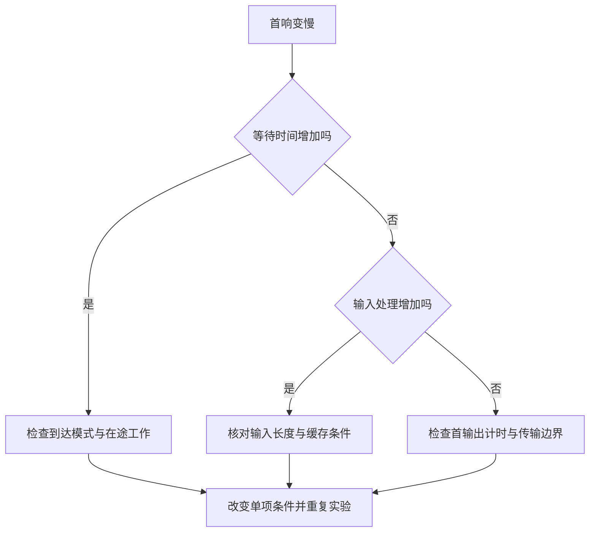

> [!NOTE] 生成演示内容
> 本文是构造的教学实验，不代表作者真实经历，也不是模型或 GPU 性能测量。示例不下载模型、不调用在线服务，只运行 Python 标准库代码。

## 两个请求，同一个服务，为什么第二个先输在等待上

设想你正在看一个流式回答界面。第一个请求很快出现文字，第二个请求却长时间停在空白。两次使用相同的模型名称，相同的服务地址，甚至相同的输出长度上限。只看这些条件，很容易把问题归结为“模型忽快忽慢”。但模型开始计算之前，请求可能已经等了很久。

我们先把这段空白拆成可以检查的事件。本例把时间零点放在服务收到第一个请求时。请求甲带着二十个输入位置到达，希望产生三个输出位置；五个模拟毫秒后，请求乙带着八十个输入位置到达，希望产生两个输出位置。这里的“位置”是教学模型的计数单位，假定它与 token 数对应，不用字符数推算，也不声称调用了真实分词器。

服务只有一个工作槽，并且采用最朴素的规则：先到先服务，一个请求完整结束以后，才开始下一个。这条规则故意放大了请求之间的阻塞，方便我们看清等待从哪里来。真实推理引擎可能会交错处理、连续批处理或分块预填充，不能用这条规则直接预测它们的性能。

读完以后，你应当能够画出一条请求时间线，说明首个输出之前花掉的时间分别属于什么阶段，并用一个反例判断“只优化模型计算”是否真的能改善用户等待。先会一点 Python 函数、列表和整数运算就够了；不需要先准备 GPU。


图的文字等价是：收到请求不等于开始计算，开始计算不等于收到首个输出，首个输出也不等于整个回答结束。排查时至少需要分别观察这三个边界。如果服务日志只有“收到”和“完成”两条记录，即使日志时间戳很精确，也无法从中直接算出首响。

## 先写契约：什么算一次请求

给请求一个稳定标识，再记录到达时间、输入规模和输出约束。这比先选择一套监控面板更有用，因为后面的每一条事件都要回到同一个请求。标识只用于关联，不能把提示词、用户身份、访问令牌或其他敏感内容当作指标标签。

我们的到达时间使用同一条模拟时间轴，单位是毫秒。输入和输出数量必须是正整数，请求标识不能重复，到达时间不能倒退。这些约束不追求覆盖真实接口的全部功能，只保证后面画出的时间线有一个明确含义。遇到不满足约束的输入，程序直接拒绝，而不是偷偷修成另一个实验。

还要把输出上限与实际输出数量分开。真实请求可能遇到结束条件而提前停止，或者被取消。预先给出的最大生成量是一项预算，不是事后测得的产出。本文为了算术可复现，明确指定每个请求实际产生的输出数量；用它讨论调度关系，不讨论生成内容或质量。

## 第一个门槛是队列，不是模型

甲在零时刻进入空闲工作槽，等待为零。乙在第五个模拟毫秒到达，但工作槽仍属于甲，因此乙必须排队。即使乙自己的工作很短，先到的长请求也能让它先耗掉一段完全没有计算的时间。这是理解首响抖动的一条简单路径。

现在把交互面板当作一张可以改变条件的实验纸。先保持默认条件，观察等待、输入处理和生成的相对位置；再改变负载，看看哪个阶段被拉长。面板中的数值来自受控教学规则，不是正在向服务器发压测请求。原始定义可以展开查看，不能运行交互时，下面的表格与代码仍然足够复现本文的结论。

```explore
{"kind":"inference","title":"请求旅程 · 改变负载，观察等待"}
```

面板使用更简化的工作量账本：请求同时到达，输入处理量按输入数量除以六十四计算，后续生成固定为八个构造工作单位；可以调整输入量、请求数和服务槽数。它展示排队、输入处理与后续生成，不把输入处理结束点声称为真实首 token。下面的手算和程序另行引入到达时间与第一个生成步，因此两者的数值不能直接对照。不要把面板上的构造单位抄进生产报告。

实验里最值得观察的，是“改变一项输入以后，哪些部分应该变化，哪些部分本应保持不变”。如果回答不了这个问题，继续增加参数通常只会让图更热闹。先用简化面板观察关系，再用完整代码追踪事件边界，可以把看懂图与验证算法连起来。

队列能吸收短暂的到达波动，但没有凭空增加处理能力。持续接收超过消化速度的工作，等待会积累。为队列加一个长度上限，也只是把一部分等待转成明确拒绝。拒绝比例、等待分布和完成数量需要放在一起看，不能只挑一个变好的数字。

## 拆开预填充与生成，才能解释不同的“慢”

为了建立可手算的模型，我们规定每个输入位置需要两个模拟毫秒，每个输出位置需要十个模拟毫秒。输入处理完成以后，再花一个生成步才得到首个输出。这是本文的教学计时约定，故意把阶段画得清楚，不对应任何模型每个 token 的真实成本。

甲处理输入需要四十毫秒，第一个输出出现在第五十毫秒，后两个输出分别出现在第六十和第七十毫秒。甲结束以后，乙才能在第七十毫秒开始；乙处理输入需要一百六十毫秒，所以首个输出出现在第二百四十毫秒，最终在第二百五十毫秒结束。

乙从到达至首个输出共等待二百三十五毫秒，其中六十五毫秒属于排队，一百六十毫秒属于输入处理，十毫秒属于我们约定的第一个生成步。把这三个数字相加，才能和用户看到的首响对上。若只报告输入处理时间，剩下的空白不会因此消失。

| 请求 | 到达 | 开始工作 | 排队 | 输入处理 | 首个输出 | 结束 | 到达至首个输出 |
| --- | ---: | ---: | ---: | ---: | ---: | ---: | ---: |
| 甲 | 0 | 0 | 0 | 40 | 50 | 70 | 50 |
| 乙 | 5 | 70 | 65 | 160 | 240 | 250 | 235 |

表中除请求名称外，所有数值单位都是模拟毫秒。下面把首响分解画成三组数值，便于横向比较；这是同一份算术结果的另一种表达，不是额外做过一轮实验。

```chart
{"title":"构造实验 · 首响时间的组成（模拟毫秒）","type":"bar","labels":["请求甲","请求乙"],"series":[{"name":"排队","values":[0,65]},{"name":"输入处理","values":[40,160]},{"name":"首个生成步","values":[10,10]}]}
```

真实自回归推理也需要区分输入上下文处理与逐步生成，但具体实现可能共享工作、分块执行，首 token 的计时边界也取决于引擎。学习这张图的目的，是先学会问阶段问题，而不是把直线长度当作一套可迁移的硬件性能公式。

## 复制这段程序，让每个数字都有出处

下面是完整程序，保存为独立文件后运行即可。它不使用真实时钟，不调用休眠，也不访问网络。与其让系统调度和机器快慢混进结果，不如先用整数时间让所有读者得到同一个答案。每次循环把前一个请求的结束时刻交给下一个请求，正是串行先到先服务规则的实现。

代码文件：`request_journey.py`；重点行：22-35

```python
def simulate(requests, prefill_ms=2, decode_ms=10):
    if type(prefill_ms) is not int or prefill_ms <= 0:
        raise ValueError("prefill_ms must be a positive integer")
    if type(decode_ms) is not int or decode_ms <= 0:
        raise ValueError("decode_ms must be a positive integer")
    available, last_arrival = 0, -1
    seen, rows = set(), []
    for name, arrival, inputs, outputs in requests:
        if not isinstance(name, str) or not name or name in seen:
            raise ValueError("request names must be unique and nonempty")
        if type(arrival) is not int or arrival < 0 or arrival < last_arrival:
            raise ValueError("arrivals must be ordered nonnegative integers")
        if any(type(value) is not int or value <= 0 for value in (inputs, outputs)):
            raise ValueError("token counts must be positive integers")
        seen.add(name)
        last_arrival = arrival
        start = max(arrival, available)
        prefill = inputs * prefill_ms
        first = start + prefill + decode_ms
        end = start + prefill + outputs * decode_ms
        available = end
        rows.append({
            "name": name, "arrival": arrival, "start": start,
            "wait": start - arrival, "prefill": prefill,
            "first": first, "end": end,
            "ttft": first - arrival,
            "latency": end - arrival,
        })
    return rows


requests = [("A", 0, 20, 3), ("B", 5, 80, 2)]
rows = simulate(requests)
assert [row["ttft"] for row in rows] == [50, 235]
assert [row["end"] for row in rows] == [70, 250]
for row in rows:
    print(row["name"], row["wait"], row["ttft"], row["latency"])
```

运行输出：

```text
A 0 50 70
B 65 235 245
```

最后一列是请求自身从到达到完成的时长，所以乙的结果是二百四十五，而不是绝对时间轴上的二百五十。二者都合理，前提是列名没有把它们混在一起。多进程或跨机器系统还有时钟问题；这个单时轴模型绕过了它，不能据此假定生产机器的时间戳天然可直接相减。

## 一个反例：只让乙更快，仍然消不掉它已经排过的队

把乙的输入从八十改成二十，保持甲完全不变。乙的输入处理由一百六十降为四十，首响由二百三十五降为一百一十五，但排队仍然是六十五。这个结果能反驳一种常见判断：只要短提示词足够短，首字就总会很快。

再做第二步，把两个请求的输入处理成本都从每位置两毫秒改为一毫秒。这时甲更早释放工作槽，乙的排队也跟着减少。优化不仅改变正在处理的请求，还可能改变后续请求的等待。只比较一条请求的耗时，容易漏掉这种传播关系。

相反，如果让甲多生成一些输出，即使乙的输入和输出约束没有变化，它仍然会在我们的串行模型里等得更久。这说明压测记录不能只保留当前请求的输入长度，还应当知道它到达时服务在处理什么、排队多少工作。否则，同一份输入得到不同首响时，你几乎没有证据解释差异。



这张图没有替你做根因判断。它把“先找一个参数调小”改成了“先定位哪一段发生变化”。即使最终问题出在图外，例如客户端读取、代理缓冲或服务端序列化，你也可以通过额外的边界事件继续细分，而不必推翻原来的调查记录。

## 缓存预算：别把能算完误当作能同时接住

时间线回答工作何时发生，内存预算回答这些工作能否同时存在。为避免把二者混为一谈，先想象每个在途请求都带着一张需要保留的状态账单。接受更多请求可能减少等待，也可能先耗尽可分配空间。是否值得接收，不能只看队列有没有位置。

对一个统一的教学假设，KV 载荷可以按“两份键和值 × 层数 × KV 头数 × 每头维度 × 保留位置数 × 每元素字节”计算。四层、两个 KV 头、每头八个元素、十六个位置、每元素两个字节，结果是四千零九十六字节。这个小数字只服务于量纲检查，绝不表示真实模型只需要这么多显存。

权重、激活、工作区、分配器开销以及安全余量都没有被算进去，实际缓存策略还会改变增长方式。把载荷估算直接除进设备总显存，会把缺失的成本误写成可用容量。若要练习公式与输入校验，可以接着读 [[演示 · 推理 04｜只估算 KV 载荷，不冒充整机容量]]。

缓存会让实现与预算产生不同取舍；例如 [Transformers 缓存策略](https://huggingface.co/docs/transformers/kv_cache)分别讨论动态、静态等策略。本文没有选择其中一种来推断速度，也没有运行它们。做自己的实验时，应先把缓存类型和结构假设写进记录，再与相同条件下的结果比较。

## 首 token、首个流式事件与平均间隔，不要共用一个名字

本文的程序明确令“一步生成”对应“一次输出”，所以首个输出和首 token 在模型里重合。真实流式传输却可能一次送出多个 token，也可能先出现没有文本的事件。服务端产生数据、网络发送、客户端收到与屏幕显示，是不同的观察边界。

当前 [vLLM 指标设计](https://docs.vllm.ai/en/latest/design/metrics/)区分相邻流式输出事件间隔与每请求的平均输出 token 耗时。后者按请求结束后计算，不能当成事件间隔逐个样本的另一种写法。使用指标前需要核对部署版本与采样边界；本文不把某个指标名称当作跨版本永远不变的协议。

在自己的记录中，先给“收到”“开始”“首个有内容的输出”“结束”四个事件写清含义，再写单位。如果只生成一个输出，后续输出之间没有间隔，平均间隔应记为不适用，而不是伪造一个零来拉低平均值。取消和失败的请求也要留在独立结果中，否则只统计成功请求会把体验最差的部分隐藏起来。

## 把实验变成别人能复查的记录

第一轮只运行上面的固定输入，核对输出和表格是否一致。第二轮只缩短乙的输入，记录排队是否不变；第三轮只延长甲的输出，观察乙的首响是否被推迟。不要同时更改工作槽数量、输入分布和输出长度，再把结果归因给其中一个因素。

一份小记录至少保留请求列表、调度规则、每阶段计时规则、输入约束、原始结果，以及没有模拟的部分。本例没有批处理、网络传输、缓存命中、抢占和取消，更没有真实模型生成。把这些限制写在结果旁边，能让未来的读者知道这个实验适合回答阶段关系问题，不适合回答应该购买哪种硬件。

练习一：把乙输入改成二十，先手算，再运行代码。提示答案是排队六十五、首响一百一十五。练习二：让甲输出五个位置，保持乙原样，乙应在第九十毫秒开始，首响变成二百五十五。练习三：传入重复标识、负到达时间、零输出和布尔值计数，确认程序都明确拒绝。

最后为单输出请求设计一条记录：首响存在，完成时长存在，但后续输出间隔不适用。这个练习比多加一张漂亮图更接近工程判断，因为它要求你对“没有观察到的数据”保留诚实的空位。

## 把问题带回真正的服务

下一次遇到空白等待，可以先画时间轴，而不是先改并发上限。找到发生变化的那一段，再决定补日志、核对输入、检查缓存，还是重新设计到达实验。若真实系统允许请求交错执行，就把“串行完成”这条教学规则替换掉；保留清楚的观察边界，替换错误的系统假设。

可以把这篇里的一个疑问摘成笔记，再到 [[演示 · 推理 05｜先定义事件，再计算首响与间隔]] 检查自己的指标定义，或到 [[演示 · 推理 06｜用预算准入和退出路径保护服务]] 继续讨论接受、拒绝与状态释放。阅读路线提供顺序，实验记录决定哪些结论值得留下。
