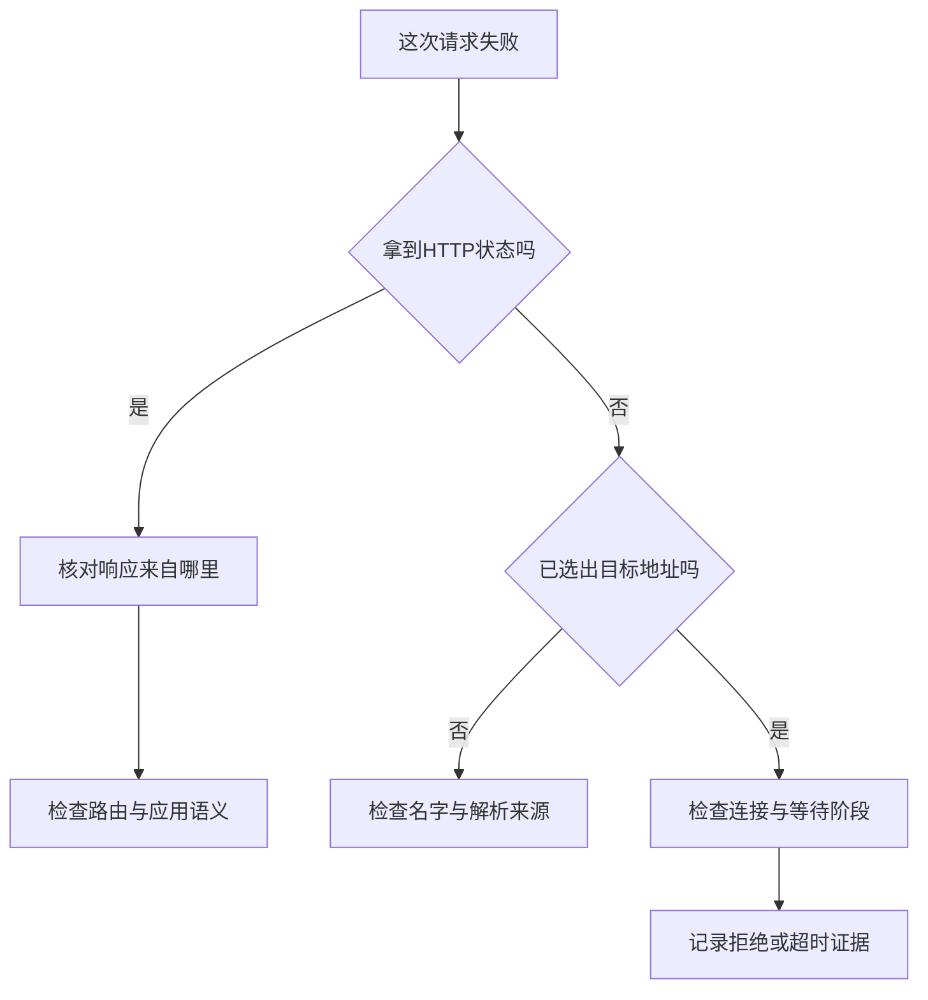

> [!NOTE] 生成演示内容
> 场景、故障和输出均为教学构造，不代表作者真实经历或线上测量。交互图不访问网络；正文实验仅访问自己创建的回环服务。这里不需要云账号、真实日志或生产服务器。

## 同一个“打不开”，可能是四件完全不同的事

假设你写好一个返回问候语的小服务。你在浏览器输入地址，页面却没有出现。第一反应可能是“网络不通”，接着换网络、重启程序、检查防火墙。做了很多动作之后服务突然恢复，你仍然不知道到底哪个动作有用，更不知道下次应该先检查哪里。

把这个场景缩小一些：一个请求访问正确路径，收到二百状态；第二个访问不存在的路径，收到四百零四；第三个连向没有监听的端口，连接被拒绝；第四个连接成功，却一直等不到响应头。它们在某些界面里都可能表现为失败，但已经经过的步骤完全不同。四百零四意味着至少有一个 HTTP 服务回答了你，连接被拒绝却还没有进入 HTTP 处理。超时只说明某段等待超过了预算，单看这个词，甚至无法判断卡在建立连接还是等待应用。

这篇文章要建立的习惯很简单：每得到一条证据，就把已经确认的范围圈出来，然后只检查下一层。我们会先画出请求的路径，再用一个只绑定本机的 Python 程序制造四种结果。最后，你会得到一张能带去检查自己的开发环境的诊断地图，而不是一份需要背诵的命令清单。

如果还没有编程经验，先看 [[演示 · Go 01｜把 Go 工具链准备好]]，也可以只阅读图和实验输出。下面的代码使用 Python 标准库；它是帮助观察协议边界的工具，不是推荐用来托管正式网站的服务实现。

## 先拆地址，不要急着拆服务器

看这个构造地址：`http://127.0.0.1:8123/hello?name=reader#example`。协议是 HTTP，主机部分是数字地址，显式端口是八千一百二十三，路径是问候资源，查询参数传递一个名字，片段用于客户端定位。浏览器不会把片段作为请求目标的一部分发送给服务器。写诊断记录时，最好把这些字段分开，避免只截一段“网址”就开始猜测。

名字和地址也不是同一回事。域名是使用者给出的名称，地址是连接需要的目标信息；同一个名字可能返回多个地址，同一个地址也可以承载多个站点。数字回环地址刻意省去了名字解析，使实验只依赖本机。`localhost` 常由系统的本地配置处理，不能把访问它等同于成功完成了一次公网 DNS 查询。

[MDN 的 URL 说明](https://developer.mozilla.org/en-US/docs/Learn_web_development/Howto/Web_mechanics/What_is_a_URL)可以作为字段含义的参考。这里最值得带走的做法是：先确认正在访问的地址与程序真正监听的位置一致。端口号写错一个数字，后续再仔细阅读应用日志也没有用，因为请求可能从未到过那个应用。


图中省略了代理、缓存、连接复用和 TLS。这个删减有意让路径保持可检查：先学会分清每一层，再为自己的真实环境加上中间环节。对于 HTTPS，TLS 验证位于相应的安全连接过程中；不能因为本文的纯 HTTP 实验成功，就宣称证书、域名和加密连接也没有问题。

## 名字找到了，为什么仍然可能找错站点

假设一个开发域名解析到了预期的地址，但返回的却是另一个页面。解析结果只能回答“连接可能去哪里”，不能单独回答“应用应该把这次请求交给哪个站点”。在常见的 HTTP 部署中，服务还会根据请求中的主机信息和路径选择处理逻辑；HTTPS 场景另有证书校验和相关配置需要核对。把几个选择过程混在一起，容易得到“既然地址对了，应用肯定对”的错误结论。

本机实验会保留请求的 `Host` 头并在成功响应中回显。你可以比较它与连接使用的数字地址和端口，但不要据此推断公网代理如何配置。实验没有反向代理，也没有域名路由，所以它只能证明这个处理器收到了什么。若真实请求经过网关，应在你有权限的配置与日志里逐段核对，而不是擅自尝试其他内部地址。

这也是为什么“能 ping 通”不足以替 HTTP 服务作证。不同工具观察的协议、权限和目标可能不同；一次底层可达的观察不能替代某个具体端口上的应用响应。排查时应记录用了什么方法、访问哪个目标、在哪个时间窗口得到什么结果，而不是只留下“通”或“不通”。

## 先在图里放一个故障

选择一种结果，沿着路径看请求停在哪里。这个部件只展示预设的教学状态，不会替你访问任何地址。先预测，再切换：如果已经看见四百零四，哪些步骤至少已经发生？如果停在名字解析，应用处理器里会不会有对应请求？

```explore
{"kind":"network","title":"请求在哪一层停下？选择故障再沿路径观察"}
```

无论图是否加载，你都能用文字得到同一个结论：解析失败时，还没有选出可连接的目标；连接被拒绝时，没有收到 HTTP 状态；收到 HTTP 错误时，已经进入应用协议；等待超时时，必须结合正在等待的阶段继续判断。图里的顺序是本文的教学模型，不能用它否认缓存、代理或复用连接带来的其他路径。

## 建立一个能主动制造结果的小实验

把下面的完整程序保存到一个新建的临时练习目录。它不会遍历目录，也不提供静态文件下载，只处理三个固定路径。系统会为服务分配一个临时端口，程序再读取实际端口；这样不用抢占你机器上已有的开发服务，也不需要管理员权限。

成功路径返回 JSON，不存在的路径返回带固定正文的四百零四。慢路径在收到请求后等待一个事件，直到客户端的读取预算耗尽才允许返回。这里制造的是应用等待，不能拿这段时间当作操作系统、网卡或 HTTP 框架的性能测试。

代码文件：`network_lab.py`；重点行：11-26,50-69

```python
import http.client
import json
import socket
import threading
from http.server import BaseHTTPRequestHandler, ThreadingHTTPServer


class Handler(BaseHTTPRequestHandler):
    slow_arrived = threading.Event()
    release_slow = threading.Event()

    def do_GET(self):
        if self.path == "/slow":
            self.slow_arrived.set()
            self.release_slow.wait(2)
            status, body = 200, b"late response"
        elif self.path == "/hello":
            status = 200
            body = json.dumps({"message": "hello", "host": self.headers.get("Host")}).encode()
        else:
            status, body = 404, b"route not found"
        try:
            self.send_response(status)
            self.send_header("Content-Type", "application/json" if self.path == "/hello" else "text/plain")
            self.send_header("Content-Length", str(len(body)))
            self.end_headers()
            self.wfile.write(body)
        except (BrokenPipeError, ConnectionResetError):
            pass  # This constructed client may have already closed after timeout.

    def log_message(self, format, *args):
        pass  # Do not mix server access logs with the expected teaching output.


server = ThreadingHTTPServer(("127.0.0.1", 0), Handler)
port = server.server_address[1]
worker = threading.Thread(target=server.serve_forever, daemon=True)
worker.start()


def fetch(path):
    connection = http.client.HTTPConnection("127.0.0.1", port, timeout=1)
    try:
        connection.request("GET", path)
        response = connection.getresponse()
        return response.status, response.read()
    finally:
        connection.close()


try:
    status, body = fetch("/hello")
    assert status == 200 and json.loads(body)["message"] == "hello"
    assert json.loads(body)["host"] == f"127.0.0.1:{port}"
    print("success: HTTP 200")
    assert fetch("/missing") == (404, b"route not found")
    print("missing: HTTP 404")

    # Reserve an unused local port without listening; never probe another service.
    with socket.socket() as reserved:
        reserved.bind(("127.0.0.1", 0))
        connection = http.client.HTTPConnection("127.0.0.1", reserved.getsockname()[1], timeout=1)
        try:
            connection.connect()  # Isolate the connection phase before sending HTTP.
            raise AssertionError("a non-listening socket unexpectedly accepted a connection")
        except ConnectionRefusedError:
            print("refused: no HTTP status")
        except (TimeoutError, socket.timeout):
            print("connect-timeout: no HTTP status")
        finally:
            connection.close()

    connection = http.client.HTTPConnection("127.0.0.1", port, timeout=0.05)
    try:
        connection.request("GET", "/slow")
        assert Handler.slow_arrived.wait(1), "slow handler did not receive the request"
        try:
            connection.getresponse()
            raise AssertionError("slow response unexpectedly arrived within budget")
        except (TimeoutError, socket.timeout):
            print("timeout: waiting for response headers")
    finally:
        connection.close()
        Handler.release_slow.set()
finally:
    Handler.release_slow.set()
    server.shutdown()
    server.server_close()
    worker.join(timeout=2)
    assert not worker.is_alive()
```

运行输出：

```text
success: HTTP 200
missing: HTTP 404
refused: no HTTP status
timeout: waiting for response headers
```

用 `python3 network_lab.py` 运行。临时端口每次可能不同，所以断言比较的是服务实际分配的值，而不是一个固定数字。主机头的断言也避免了只看到问候文本就误认为自己理解了请求目标。四行输出分别记录不同阶段，不能合并成一个布尔值。这一分支先单独调用 `connect()`，在发送 HTTP 前观察连接结果。第三行展示常见的连接拒绝；部分系统或本机网络策略会让这一行变成 `connect-timeout: no HTTP status`。这时观察到的是连接阶段超时，不能把它伪装成已经收到拒绝。两种结果都尚未得到 HTTP 状态；其余三行仍须精确匹配。Python 版本间超时异常的继承关系不同，因此程序同时捕获 `TimeoutError` 与 `socket.timeout`。

代码用事件确认慢处理器已经接到请求，再等待响应头超时。这比随意休眠后猜测阶段更清楚，但仍受到本机线程调度和运行环境影响。如果练习环境极度繁忙，前面的事件等待也可能失败；此时应记录失败的断言，不应把程序改成无条件打印“通过”。

## 四百零四其实带来了一条好证据

当第二次请求收到四百零四时，客户端已经完成了这次 HTTP 交换所需的连接与请求发送，服务也确实产生了响应。这里的失败属于我们写下的路由规则。若你因此转去修改名字解析，既无法修复路径，还可能增加一个新的故障。

但是，收到四百零四不代表“一切网络都正常”。真实系统中，它可能来自代理而非预期应用，或来自一个默认站点；应通过请求标识、响应内容和受控服务日志继续确认。状态码是一条缩小范围的证据，不是整条链路的健康证明。类似地，成功读取响应头也不保证正文会完整传输，流式读取过程中仍可能失败。

连接被拒绝则没有四百零四或五百状态。此时 `HTTPConnection` 无法完成它需要的连接，异常发生在得到响应对象之前。本实验明确持有一个只绑定但不监听的本机套接字，让目标在实验期间保持非监听状态，但操作系统或网络策略可能表现为连接超时；只有捕获 `ConnectionRefusedError` 时才称为拒绝。在真实网络中，拒绝也可能涉及不同主机或中间设备，不能只凭异常文本断言某台应用“肯定没启动”。



## 超时是一份预算，不是一份根因报告

把读取超时从五十毫秒改成五百毫秒，慢请求仍可能失败，因为服务端等待的是事件而不是某个固定工作时长。若把 `release_slow` 提前设置，响应就可以完成。这个对照说明“允许多等一些”和“让工作能够完成”是两件不同的事。

真实调用还可能有连接预算、读写等待、总截止时间以及上游自己的预算。一个参数未必覆盖所有阶段，多个阶段也未必共享同一个截止时间。排查前先查所用客户端的具体语义，再记录预算究竟约束什么；不要把“设置了一个超时数字”误写成“整个调用最多持续这么久”。

重试会消耗更多预算，并可能重复已经发生的副作用。即使没有收到响应，也不能直接推断服务器没有执行操作。本文只发送没有业务写入的构造 GET 请求，没有演示如何安全重试支付、创建资源等操作。要研究那个问题，应接着区分幂等约定、请求标识和总预算，而不是给所有失败统一套一个循环。

## 把排查写成一张证据地图

下面的地图按本篇简化链路组织。它没有要求你把每个工具都运行一遍，而是帮助选择能验证当前假设的下一步。只对自己有权限的本机开发服务使用，不扫描地址段，不把真实响应、密钥或内部域名复制进公开文章。

| 已有观察 | 能支持什么 | 仍不能证明什么 | 下一步检查 |
| --- | --- | --- | --- |
| 地址字段已经拆开 | 目标协议、主机、端口、路径可审查 | 程序实际监听在这里 | 核对启动配置和实际监听 |
| 名字得到预期地址 | 某次解析选择符合预期 | 目标端口开放、站点选择正确 | 连接目标与主机信息 |
| 连接被拒绝 | 未取得本次 HTTP 响应 | 唯一根因是应用停机 | 本机监听与目标是否一致 |
| 收到四百零四 | 某个服务返回了 HTTP 状态 | 一定是预期后端返回 | 来源、路径与代理路由 |
| 处理器已接收但读超时 | 至少到达本例应用等待阶段 | 工作没有执行或重试安全 | 等待事件、截止时间与副作用 |

在 Linux 上，`ss -ltn` 可作为只读查看监听套接字的起点，`/proc` 则涉及进程相关状态；输出可见范围受系统和权限影响。这些 Linux 专用步骤没有在本次 macOS 开发环境冒充验证。先阅读 [[演示 · 进程与文件描述符：名字背后还有一次打开]]，再在自己的 Linux 练习环境观察，能把“谁监听、谁持有资源”连接起来。

## 三个需要自己作答的小实验

第一个任务是只改路径，不改目标地址与端口，让成功请求变成四百零四。运行前写下你预计会改变的输出，再说明为什么连接拒绝那一行不受影响。答案线索在处理器的分支：路径属于服务收到请求之后的选择，连接目标没有因此改变。

第二个任务是让慢路径成功。不要只把超时无限调大，而是选择一个清楚的位置释放事件，并把成功响应断言补上。答案线索是客户端已经用事件确认服务收到请求，接下来决定工作是否可以继续。完成后恢复原来的超时演示，保证成功和失败两种实验都能复现。

第三个任务是写一份三句话的故障记录：第一句描述目标和阶段，第二句只写实际观察，第三句提出一个能被推翻的假设及下一步。比如“处理器收到固定路径，客户端在响应头前超时；事件尚未释放；先验证释放事件后能否完成响应”。这比“网络卡了，重启试试”更容易让另一个人复查。

## 回到真实服务之前

这个实验没有 DNS 服务器、TLS、容器网络、反向代理、连接池、重定向或跨主机链路。它证明的是四种本机教学路径可以被区分，不是你的真实部署已经完成诊断。迁移到更复杂的环境时，应在图中补回每个实际存在的中间环节，并为观察标明来源和时间窗口。

保留一份能运行的小实验，比保留几十条不知出处的命令更有帮助。遇到故障时，你可以先问：哪个环节已经有证据，哪个环节还只是猜测？随着理解深入，诊断地图可以越来越丰富，但每次行动仍然只回答一个具体问题。

## 来源与继续阅读

- [MDN：URL 的结构](https://developer.mozilla.org/en-US/docs/Learn_web_development/Howto/Web_mechanics/What_is_a_URL)：协议、主机、路径、查询和片段的定义。
- [MDN：HTTP 概览](https://developer.mozilla.org/en-US/docs/Web/HTTP/Guides/Overview)：请求、响应与客户端和服务器之间的关系。
- [Python：`http.server`](https://docs.python.org/3/library/http.server.html)：本机教学服务使用的处理器和线程服务类；文档明确不推荐用于生产。
- [Python：`socket`](https://docs.python.org/3/library/socket.html)：地址、套接字和超时接口；部分行为依赖操作系统。

接着把实验中的请求和响应概念整理到 [[演示 · 让 HTTP 在本机走一趟：请求、状态与响应体]]，或者沿 [[演示 · 超时与重试：先限制总预算，再决定是否再试]] 继续研究时间预算。
