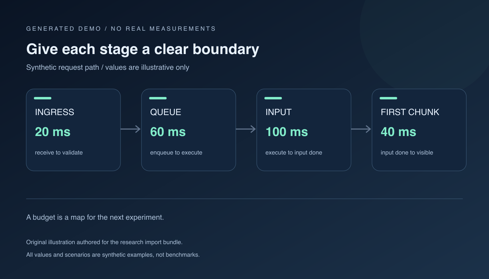

> [!NOTE] 生成演示材料
> 本文由本次任务生成。场景、数字、图表和示意图均为构造内容，不代表真实经历、生产指标或实测结果；请用自己的证据替换后再用于工程决策。

## 先把一句“慢”拆开

设想一个虚构的内部问答服务：请求通过入口进入队列，等待一个推理执行槽位，完成输入处理后生成回答。有人说“今天有点慢”，这句话可以成为调查入口，却还不能成为优化任务。它没有说明请求规模、等待发生的位置，也没有区分首段内容出现之前的时间与完整回答结束之前的时间。

这份演示从一张可修改的预算表开始。表中的毫秒数是为了练习分配问题而人工填写的，不是某种硬件的能力承诺。我们把一次请求当作一条需要解释的路径：入口验证、排队、输入处理、首段输出、后续生成。先约定边界，再讨论哪个阶段值得增加观测。否则，同一个“首响应”名称可能在两份报表里指向不同事件。



| 阶段 | 演示预算 / 毫秒 | 起止事件 | 下一项待确认信息 |
| --- | ---: | --- | --- |
| 入口 | 20 | 接收请求到校验结束 | 是否含正文读取 |
| 排队 | 60 | 入队到获得执行槽位 | 是否有优先级队列 |
| 输入处理 | 100 | 执行开始到输入处理结束 | 输入长度如何分组 |
| 首段输出 | 40 | 输入处理结束到首段可见 | 网络缓冲是否单独统计 |

## 让时间戳承担清楚的责任

下面的代码只描述事件边界，不会发送请求。事件名刻意比仪表盘标签更具体。实际埋点时，应先确认时间来自哪一个进程、哪一个时钟，再决定哪些时间差可以相减。跨服务直接相减并不自动可靠，特别是当一端记录了接收时刻，另一端记录了发送完成时刻时。

```python
# 生成演示：只展示字段结构，不连接任何真实服务。
events = {
    "request_received_ms": 0,
    "validation_finished_ms": 20,
    "queue_entered_ms": 20,
    "execution_started_ms": 80,
    "input_finished_ms": 180,
    "first_chunk_visible_ms": 220,
}
queue_ms = events["execution_started_ms"] - events["queue_entered_ms"]
print({"demo": True, "queue_ms": queue_ms})
```

一个实用的记录方式，是把每项指标旁边的未知条件也写下来。输入长度是否包含系统提示？命中缓存的请求是否进入同一分组？超时请求是作为失败单独列出，还是在展示中被过滤？这些条件不会让图变得漂亮，但会决定两个实验能否比较。记录缺失时，应把结论写成“需要补证”，而不是给原因补上一段听起来合理的故事。

## 只画能解释的构造数据

以下图表使用本页面支持的 `chart` 围栏。四组输入规模只是演示标签，两个序列也只是人工构造的练习数据。第二条线比第一条线低，只说明我们希望在界面中演示两条曲线的对照；它不能证明某项优化有效。阅读时可以尝试切换序列、查看数值，再回到正文寻找每个标签的定义。

```chart
{
  "title": "生成演示 · 不同输入组的首段时间（人工构造，毫秒）",
  "type": "line",
  "labels": ["短输入 A", "短输入 B", "中输入 C", "长输入 D"],
  "series": [
    {"name": "构造方案甲", "values": [160, 190, 270, 390]},
    {"name": "构造方案乙", "values": [150, 180, 250, 370]}
  ]
}
```

## 把怀疑写成能被否定的假设

“队列有问题”缺少可失败的条件。更有用的演示假设是：在输入组、输出上限和并发设置固定时，如果排队时间占比上升，而执行阶段没有同方向变化，那么下一轮应优先调查准入与调度。这个假设仍然可能被否定，例如观测发现执行槽位的计时边界改变了，或者请求组在实验过程中发生了漂移。

此时可以在 [[演示 · 可复现实验不是只存一条命令]] 中建立两次独立运行。每次保留配置摘要、输入清单标识、失败数量和原始输出路径。一次只改变一个主要条件并不是万能要求；确实需要同时改变多个条件时，也要明确写出组合，避免把组合结果归功于其中最熟悉的一项。

> 预算是下一次实验的地图，不是这一次结果的奖状。

这句话适合作为本页的批注练习。选中它后，可以留下“后续要给排队阶段增加证据”的备注。刷新之后再核对批注是否仍然锚定这句话；修改原文后，也应检查界面是否清楚提示原文变化。批注的价值在于保留问题，不能代替实验本身。

## 为下一位阅读者留下撤回条件

假设我们准备调整队列参数，记录里应同时出现预期收益和停止条件。演示中的停止条件可以写成：错误类型出现新的集中分布、请求组不再可比、或者观测字段发生缺失时，暂停解释结果，先恢复可比较的采集条件。真正执行时，阈值需要由服务目标与现有证据决定，不能直接复制这份示例。

源码阅读也可以为预算补充证据，但要分开记录“函数接受什么参数”“调用链可能怎样经过这里”和“本次请求是否真的经过这里”。前两项可以从静态代码提取，最后一项需要运行证据。[[演示 · 源码阅读要留下可回查的证据]] 给出了这种分层记录的模板。

最后，把调查状态写成一项可交接的工作：当前已经确认事件边界，尚未确认输入分组是否稳定，下一次运行由谁检查原始输出，以及什么现象会让本轮假设失效。若需要把观察转为操作步骤，继续阅读 [[演示 · 把复盘结论写成可撤回的运行手册]]。这样一份预算不必一次写完，但每次修改都能解释为何增加了一个字段、删掉了一个猜测。
