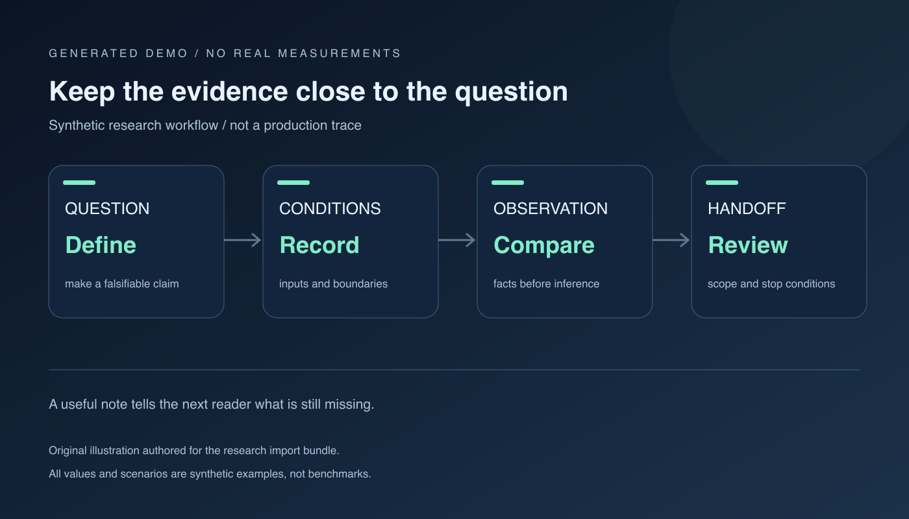
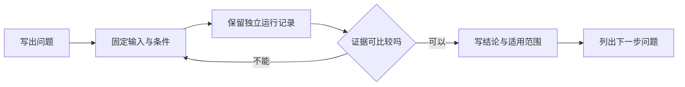

> [!NOTE] 生成演示材料
> 本文由本次任务生成，实验编号、输入标识、配置和结果都是虚构样例，不代表真实运行、真实测量或作者经历。

## 从一张实验卡片开始

```json
{
  "demo": true,
  "experiment_id": "demo-queue-comparison-001",
  "question": "固定输入组时，调度方案是否改变排队分布？",
  "input_manifest": "demo-input-set-a",
  "configuration": {"concurrency": 4, "output_limit": 128},
  "changed_condition": "人工构造的方案标签",
  "measurement_status": "not-run"
}
```

卡片先写 `not-run`，可以避免一份计划在转发后变成“已经验证过”。当资料跨过笔记、聊天和汇报三个界面，语气往往比附件保存得更久。因此，我们把状态写成数据的一部分，并在每张图上重复声明构造性质。读者无需知道这份笔记来自哪里，就能理解它目前只能用于演示。

## 记录输入，不只记录命令

一条命令通常解释如何启动程序，却不解释输入有没有改变。演示记录可以保存输入清单的逻辑名称、生成方法、行数及摘要；真实环境中再替换为可回查的版本标识。不能为了追求“完整”把客户原文和凭据复制到笔记里，记录足以重建对比条件的非敏感标识即可。

| 字段 | 构造示例 | 缺失时的影响 |
| --- | --- | --- |
| 问题 | 对比两个调度标签 | 结果容易被换一种说法解释 |
| 输入组 | demo-input-set-a | 无法确认请求是否可比 |
| 固定条件 | 并发 4，输出上限 128 | 无法定位变化来源 |
| 采集状态 | 尚未运行 | 计划可能被误当作结论 |
| 失败样本 | 空清单，待运行后填写 | 只保留成功结果会遮住问题 |

## 保留每次运行的独立性

不要把第二轮输出覆盖到第一轮目录，也不要为了展示整齐提前删除失败记录。一个运行单元应能够独立回答：它打算验证什么、实际采用什么条件、有哪些异常、结论是否仍然成立。即使最终判断是“本次不可比较”，这仍然是一项有价值的实验结果，因为它指出了下一轮应该修复的条件。

```python
# 生成演示：仅在终端输出一条构造记录。
import json

record = {
    "demo": True,
    "run": "demo-run-b",
    "status": "planned",
    "observations": [],
    "invalid_if": ["input group changes", "missing queue timestamps"],
}
print(json.dumps(record, ensure_ascii=False, indent=2))
```

## 结论需要写出适用范围

从 [[演示 · 把推理延迟拆成可讨论的预算]] 带来的问题，不一定能在这一页得到答案。若输入组还没有固定，我们应明确写“尚无可比较证据”。若观察只覆盖一个构造场景，应写“仅用于该场景下的演示讨论”。这种边界让下一位读者能安排补充实验，也让之后的修订有明确起点。





> 可复现的起点，是另一位读者知道自己还缺什么。

实验卡片可以和 [[演示 · 源码阅读要留下可回查的证据]] 并排打开：左侧记录运行观察，右侧记录代码事实。两者互相补充，却不自动互相证明。当改动准备进入运行流程时，再从 [[演示 · 把复盘结论写成可撤回的运行手册]] 补齐检查与撤回步骤。
