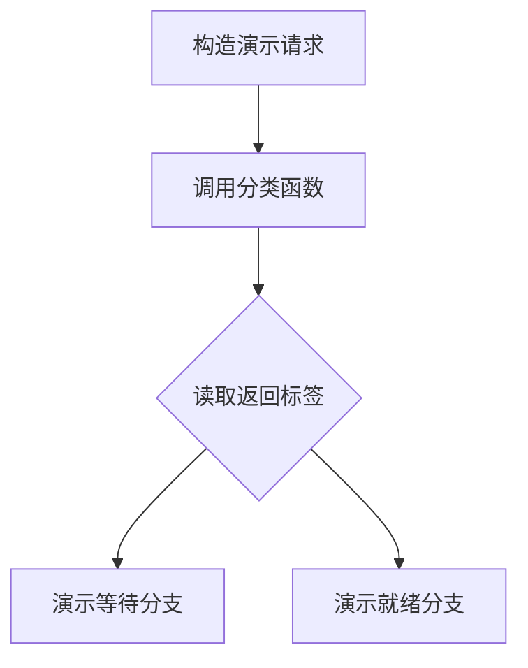

> [!NOTE] 生成演示材料
> 本文由本次任务生成。函数、版本标识和调用路径全部虚构，不对应任何真实项目，不代表真实源码调查或实测结论。

## 用一个虚构函数练习

```go
// 生成演示伪代码：用于说明阅读记录，不是生产调度器。
type DemoRequest struct {
    ID      string
    CanWait bool
}

func classifyDemoRequest(request DemoRequest) string {
    if request.CanWait {
        return "waiting"
    }
    return "ready"
}
```

读到这里，可以确认函数按布尔字段返回两个固定字符串。还不能确认任何线上请求会经过这个函数，也不能确认 `CanWait` 在业务上代表何种优先级。一个简短函数很容易让人产生“已经理解全链路”的感觉，所以证据笔记需要主动保留尚未观察的部分。

## 先分清三种句子

| 类型 | 本示例可以写下的句子 | 所需的下一项证据 |
| --- | --- | --- |
| 事实 | 字段为真时返回 waiting | 当前代码片段已经足够 |
| 推断 | 调用方可能据此选择等待队列 | 查找调用方及其分支 |
| 疑问 | 哪些请求会把字段设为真 | 查找构造入口及测试场景 |
| 运行判断 | 某请求实际进入等待队列 | 需要可关联的运行观察 |

每条事实最好附带可回查位置。这里使用虚构标识 `demo-source-v1` 和逻辑路径 `demo/scheduler.go`，只用于展示字段。真实资料中应替换成实际可访问的版本与位置，避免只写“最新代码”。当代码位置变化时，版本标识还能解释这条笔记为何在当时成立。

## 调用链是一条寻找证据的路线



上图只表示待核对的阅读路径。阅读实际代码时，先检查调用参数，再检查返回值的使用方式，随后检查异常与测试。若函数有多个调用点，不能从一个调用点的上下文推导所有调用点的含义；可以把各自的前置条件列成表，等证据足够后再合并描述。

> 一条能回到原处的证据，比一段没有边界的解释更耐用。


## 把未解的问题接到实验上

当源码里出现看似合理的条件分支，可以在 [[演示 · 可复现实验不是只存一条命令]] 建立一个验证条目：需要什么输入、观察哪个事件、什么结果会否定当前推断。这样，阅读笔记不会变成只积累术语的仓库，而是为下一次调查准备问题。

如果调查起因是延迟，回到 [[演示 · 把推理延迟拆成可讨论的预算]] 对齐时间边界。若准备让其他人执行操作，则转入 [[演示 · 把复盘结论写成可撤回的运行手册]]，把阅读证据、执行条件与撤回判断放在同一条可检查的链上。
