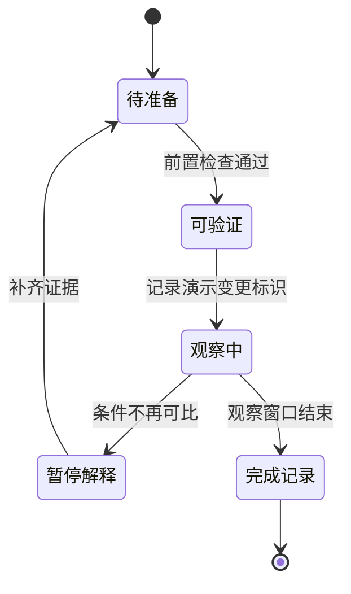

> [!NOTE] 生成演示材料
> 本文由本次任务生成。事件、角色、步骤及状态均为虚构内容，不是故障报告或生产操作建议，不包含可执行的集群变更命令。

## 先写操作何时不该开始

假设一项虚构的队列策略变更准备进入验证窗口。复盘笔记如果只写“加强监控”，下一位执行者依然不知道要看什么。演示手册先写三个前置条件：输入组可以对齐，关键事件能够采集，撤回所需的旧配置可以定位。任何一项无法确认，状态都应停在“待准备”。

| 检查点 | 演示中需要留下的记录 | 未通过时的动作 |
| --- | --- | --- |
| 输入边界 | 对比组的清单标识一致 | 补齐记录后再开始 |
| 观察能力 | 排队和执行事件都可见 | 先修复采集条件 |
| 变更范围 | 只包含计划内演示实例 | 重新核对作用范围 |
| 撤回准备 | 旧配置标识可回查 | 保持待准备状态 |
| 负责人 | 观察者与执行者职责明确 | 暂停安排验证窗口 |

这些检查点强调需要留证据，而不替任何真实系统定义合格阈值。阈值必须来自具体服务目标、历史观察和当次授权范围，不能从本演示中的文字反推。

## 把步骤写成状态变化



“暂停解释”不等于已经完成撤回，它表示目前没有资格继续给结果下结论。真实运行手册还应分别写清停止新变更、恢复旧配置、核对状态和对外沟通的责任。把这些动作揉成一个“回滚”按钮的名字，容易在交接时遗漏确认步骤。

```yaml
# 生成演示结构：不是任何真实部署工具的配置。
demo: true
record_id: demo-review-001
state: waiting-for-evidence
entry_checks:
  - comparable-input-group
  - complete-event-boundaries
stop_conditions:
  - observation-fields-missing
  - experiment-scope-changed
next_record: demo-handoff-note
```

## 复盘要能改变下一次行动

[[演示 · 把推理延迟拆成可讨论的预算]] 负责把问题拆开；[[演示 · 可复现实验不是只存一条命令]] 保留运行条件；[[演示 · 源码阅读要留下可回查的证据]] 解释静态代码事实。运行手册将这三类资料连接起来，指定下一次应该由谁检查哪一份证据，以及出现什么现象需要停止。

> 复盘留下的不是一句“下次注意”，而是下一次能够检查的条件。


收尾时写一条交接记录：已经完成哪些检查，哪些问题仍未回答，旧配置在哪里可以定位，下一位阅读者从哪篇笔记开始。示例 TXT 文档 [[演示 · 轮值交接便笺]] 可以作为这一部分的最小模板。专题里的顺序阅读适合从问题走到行动，并排阅读适合核对结论有没有超出证据。
